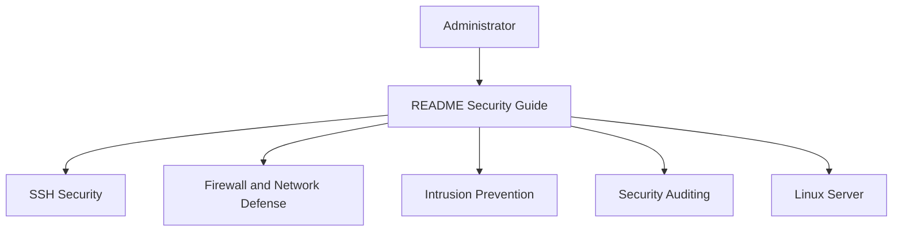

# imthenachoman/How-To-Secure-A-Linux-Server

> Step-by-step guide to hardening a home Linux server, for anyone administering their own machine.

## The problem
Linux security advice is scattered across hundreds of articles, and the basics get forgotten when you rarely set up a server.

## What it actually does
A long README, organized in order: preparation, SSH (Ed25519 keys, AllowGroups group, `sshd_config`), account control, system hardening, firewall, intrusion prevention, auditing, integrity checking, logs, e-mail. Each step provides commands to copy. Separate guides cover sysctl and Nginx. A set of Ansible playbooks exists in another repository.

## How it is wired



## Trying it
```bash
ssh-keygen -t ed25519
ssh-copy-id user@server
sudo groupadd sshusers
sudo usermod -a -G sshusers user1
```

## Cost and gotchas
Free, but there is a risk of locking yourself out of the server: the guide advises keeping a second SSH session open. The snippets are written and tested on Debian.

## What it is not
Not an automation tool, but a text to read. It targets the home, not professional environments. It does not replace the CIS benchmarks, and its "To do" list shows topics still missing (SELinux, AppArmor, disk encryption).

## Alternatives
- CIS Benchmarks: more exhaustive, to be read after this guide according to the author.
- How To Secure A Linux Server With Ansible (moltenbit): automated version with playbooks.

## For you
Watch: a good base for hardening a GPU machine or a personal experimentation server, but not sufficient for production.
