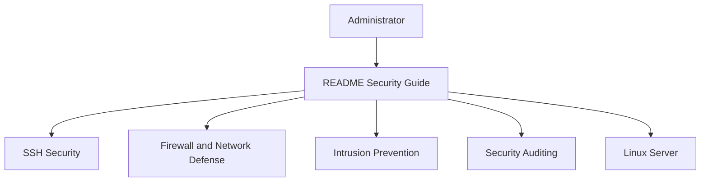

# imthenachoman/How-To-Secure-A-Linux-Server

> Guide pas à pas pour durcir un serveur Linux domestique, pour qui administre sa propre machine.

## Le problème
Les conseils de sécurité Linux sont dispersés dans des centaines d'articles, et on oublie les basiques quand on installe rarement un serveur.

## Ce que ça fait vraiment
Un README long, organisé dans l'ordre : préparation, SSH (clés Ed25519, groupe AllowGroups, `sshd_config`), contrôle des comptes, durcissement système, pare-feu, prévention d'intrusion, audit, vérification d'intégrité, journaux, e-mail. Chaque étape fournit des commandes à copier. Des guides séparés couvrent sysctl et Nginx. Un jeu de playbooks Ansible existe dans un autre dépôt.

## Comment c'est branché



## Essayer
```bash
ssh-keygen -t ed25519
ssh-copy-id user@server
sudo groupadd sshusers
sudo usermod -a -G sshusers user1
```

## Coût et pièges
Gratuit, mais risque de s'enfermer hors du serveur : le guide conseille de garder une seconde session SSH ouverte. Les extraits sont écrits et testés sur Debian.

## Ce que ce n'est pas
Ce n'est pas un outil d'automatisation, mais un texte à lire. Il vise le domicile, pas les environnements professionnels. Il ne remplace pas les benchmarks CIS, et sa liste « À faire » montre des sujets encore absents (SELinux, AppArmor, chiffrement disque).

## Alternatives
- CIS Benchmarks : plus exhaustifs, à lire après ce guide selon l'auteur.
- How To Secure A Linux Server With Ansible (moltenbit) : version automatisée par playbooks.

## Pour toi
À surveiller : bonne base pour durcir une machine GPU ou un serveur d'expérimentation personnel, mais pas suffisant pour de la production.

