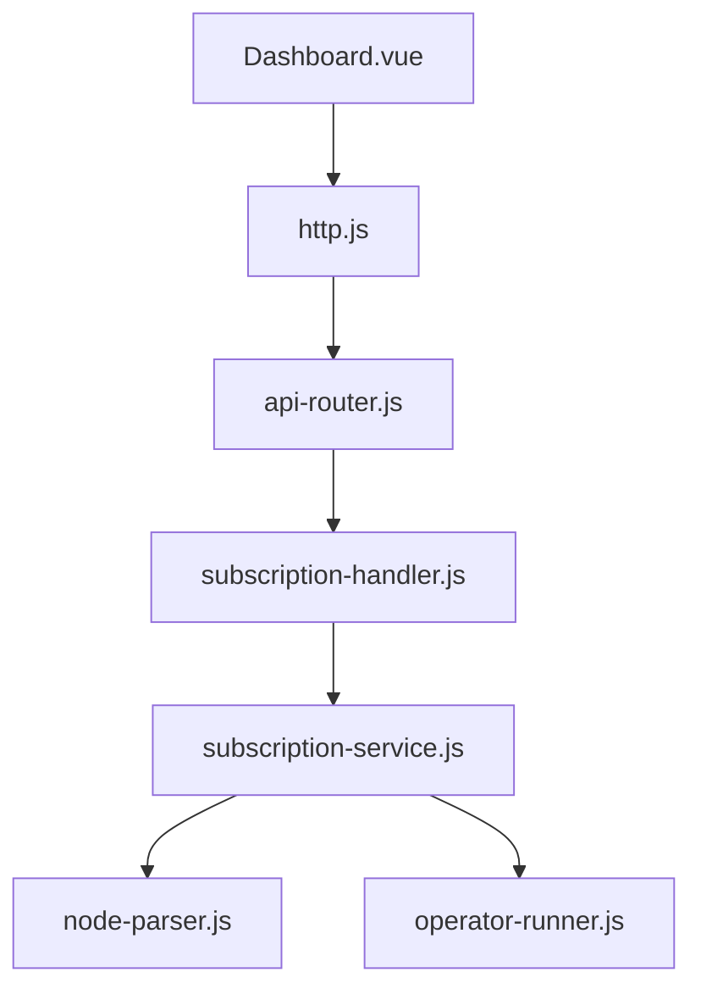

# imzyb/MiSub

> Proxy subscription management panel, deployed on Cloudflare Pages, for individuals and small teams.

## The problem
Managing several proxy subscriptions and nodes and serving them in formats compatible with each client is tedious.

## What it actually does
A Vue 3 interface connected to Pages functions: merging subscriptions into profiles, an operator chain (filter, regex rename, sort, deduplication), output for Clash, Sing-Box, Surge, Loon and others. Storage on Cloudflare KV or D1, Telegram notifications.

## How it is wired


## Trying it
```bash
npm install
npm run dev
npm test -- --run
npm run build
```

## Cost and gotchas
Free. Requires a GitHub account and a Cloudflare account, plus a linked KV namespace. If `ADMIN_PASSWORD` is not set, the default password is `admin`.

## What it is not
Not a proxy or VPN service: only a manager of subscription links.

## Alternatives
No alternative named in the README.

## For you
Ignore: a personal network circumvention tool, unrelated to data / AI / MLOps work.
