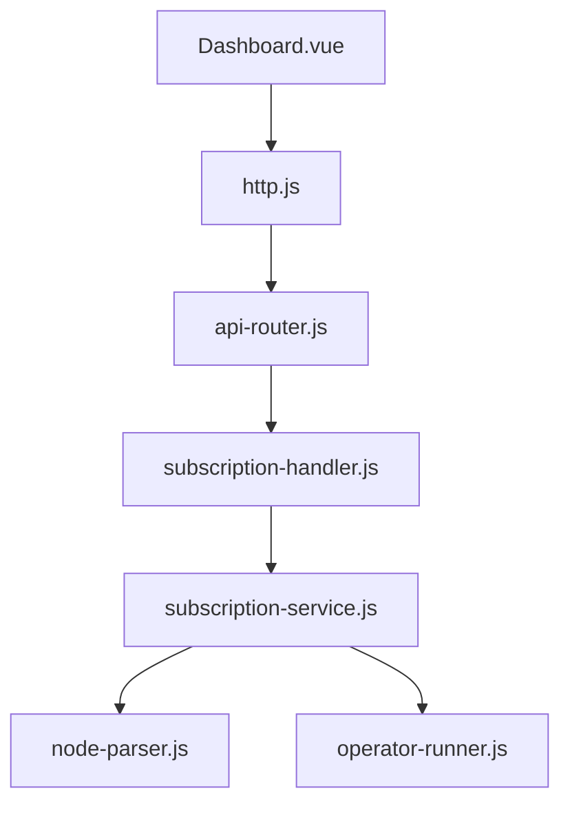

# imzyb/MiSub

> Panneau de gestion d'abonnements proxy, déployé sur Cloudflare Pages, pour particuliers et petites équipes.

## Le problème
Gérer plusieurs abonnements et nœuds proxy et les fournir en formats compatibles avec chaque client est fastidieux.

## Ce que ça fait vraiment
Interface Vue 3 reliée à des fonctions Pages : fusion d'abonnements en profils, chaîne d'opérateurs (filtre, renommage regex, tri, déduplication), sortie pour Clash, Sing-Box, Surge, Loon et autres. Stockage Cloudflare KV ou D1, notifications Telegram.

## Comment c'est branché


## Essayer
```bash
npm install
npm run dev
npm test -- --run
npm run build
```

## Coût et pièges
Gratuit. Exige un compte GitHub et un compte Cloudflare, plus un espace KV lié. Si `ADMIN_PASSWORD` n'est pas défini, le mot de passe par défaut est `admin`.

## Ce que ce n'est pas
Pas un service de proxy ni de VPN : seulement un gestionnaire de liens d'abonnement.

## Alternatives
Aucune alternative nommée dans le README.

## Pour toi
Ignorer : outil de contournement réseau personnel, sans lien avec un travail data / IA / MLOps.

