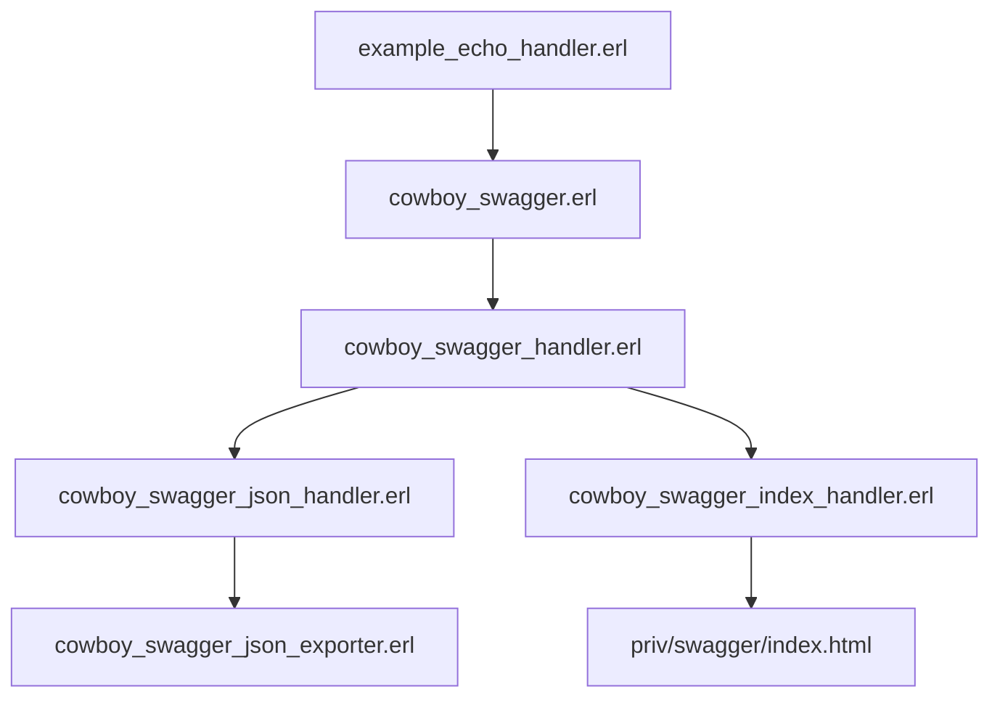

# inaka/cowboy_swagger

> Erlang library that generates the Swagger documentation of a Cowboy API, for Erlang developers.

## The problem
Documenting a Cowboy REST API by hand is slow and goes stale. There is no simple Erlang tool for this, says the README.

## What it actually does
It reads the "trails" metadata declared in each handler, aggregates it into a Swagger specification served as JSON, then serves the embedded Swagger UI under `/api-docs`. Configuration goes through a `*.config` file (base path, global or per-server specification, definitions).

## How it is wired
Simplified diagram based on the sheet and the provided diagram.



## Trying it
```bash
# aucune commande shell dans le README : tout passe par du code Erlang
# 1. déclarer trails/0 dans chaque handler (métadonnées Swagger)
# 2. ajouter cowboy_swagger_handler à trails:trails([...])
# 3. ajouter cowboy_swagger dans applications de *.app.src
# puis ouvrir http://localhost:8080/api-docs
```

## Cost and gotchas
Free. Requires trails and Cowboy; the `static_files` path changes when used as a dependency (`./deps/cowboy_swagger/priv/swagger`). A server uses either `global_spec` or `server_spec`, never both.

## What it is not
Not an automatic generator from the code: the metadata has to be written by hand. Restricted to the Erlang/Cowboy ecosystem.

## Alternatives
No alternative named in the README.

## For you
Keep an eye on it: useful only if you expose a Cowboy API in Erlang, outside your usual data/AI territory.
