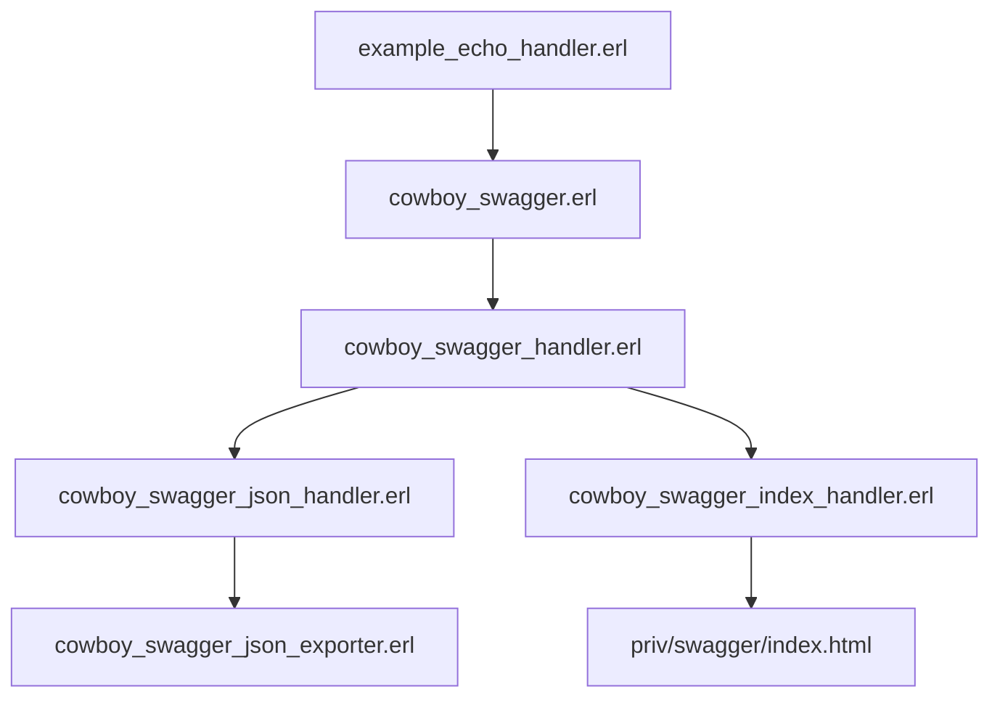

# inaka/cowboy_swagger

> Bibliothèque Erlang qui génère la documentation Swagger d'une API Cowboy, pour les développeurs Erlang.

## Le problème
Documenter à la main une API REST Cowboy est lent et se périme. Il n'existe pas d'outil Erlang simple pour cela, dit le README.

## Ce que ça fait vraiment
Elle lit les métadonnées « trails » déclarées dans chaque handler, les agrège en une spécification Swagger servie en JSON, puis sert l'interface Swagger UI embarquée sous `/api-docs`. La configuration passe par un fichier `*.config` (chemin de base, spécification globale ou par serveur, définitions).

## Comment c'est branché
Schéma simplifié d'après la fiche et le diagramme fourni.



## Essayer
```bash
# aucune commande shell dans le README : tout passe par du code Erlang
# 1. déclarer trails/0 dans chaque handler (métadonnées Swagger)
# 2. ajouter cowboy_swagger_handler à trails:trails([...])
# 3. ajouter cowboy_swagger dans applications de *.app.src
# puis ouvrir http://localhost:8080/api-docs
```

## Coût et pièges
Gratuit. Exige trails et Cowboy ; le chemin `static_files` change selon l'usage en dépendance (`./deps/cowboy_swagger/priv/swagger`). Un serveur utilise soit `global_spec`, soit `server_spec`, jamais les deux.

## Ce que ce n'est pas
Pas un générateur automatique depuis le code : les métadonnées sont à écrire à la main. Réservé à l'écosystème Erlang/Cowboy.

## Alternatives
Aucune alternative nommée dans le README.

## Pour toi
Surveiller : utile seulement si tu exposes une API Cowboy en Erlang, hors de ton terrain data/IA habituel.

