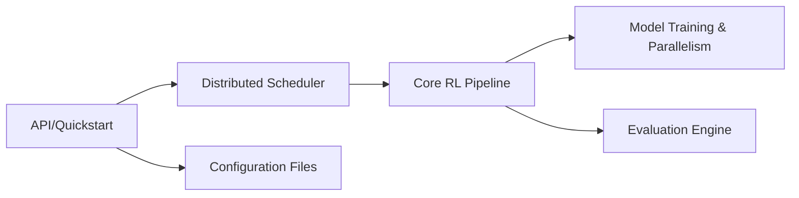

# inclusionAI/AReaL

> Asynchronous reinforcement learning infrastructure for training reasoning models and agents, for ML teams with GPUs.

## The problem
Training an LLM with RL at scale stalls when generation and training wait for each other.

## What it actually does
Asynchronous RL training (GRPO, PPO, DAPO, GSPO, etc.) with Megatron, FSDP or Archon backends and SGLang or vLLM inference. Examples: math, code agents, search, VLM, RLHF. An external agent trains by changing the `base_url`.

## How it is wired


## Trying it
```bash
git clone https://github.com/areal-project/AReaL
cd AReaL
pip install uv
uv sync --extra cuda
python3 examples/math/gsm8k_rl.py --config examples/math/gsm8k_grpo.yaml scheduler.type=local
```

## Cost and gotchas
CUDA GPU required, flash-attn wheel to pick according to Python, Ray cluster for multi-node. The provided diagram describes an old tree (`realhf`): do not rely on it.

## What it is not
Not a simple fine-tuning library. The license is not declared in the catalog.

## Alternatives
The README cites VeRL, OpenRLHF and DeepScaleR as projects it draws inspiration from.

## For you
Worth watching: relevant only if you train models with RL on GPUs; otherwise it is too heavy.
