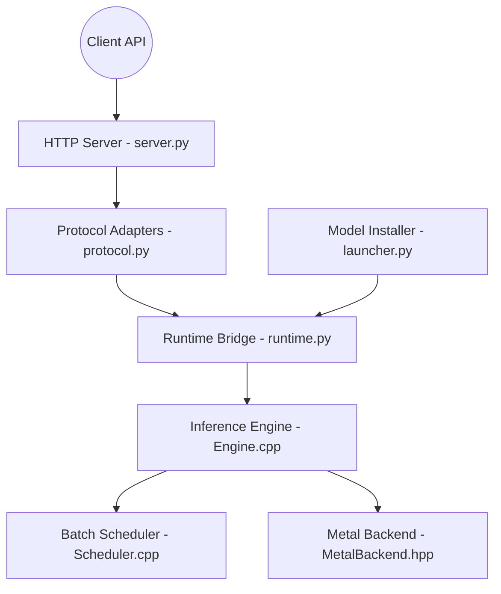

# incoai/splash

> Local inference engine for Apple silicon Macs, compatible with the OpenAI and Anthropic APIs, with speculative decoding.

## The problem
Running a coding agent on a local model at a usable speed is still slow on a Mac with llama.cpp.

## What it actually does
Pairs each model family (Qwen3.8-27B, Qwen3.6-35B-A3B, etc.) with a DFlash2 draft model and dedicated Metal kernels, with automatic memory planning. Serves Chat Completions, Responses, Completions and Messages, with streaming, tools, JSON Schema output, images and PDFs. Shares cached prefixes and batches concurrent requests. Launches `opencode`, `claude`, `codex`, `hermes` or `pi` with a single command.

## How it is wired


## Trying it
```bash
brew install incoai/tap/splash
splash serve --model unsloth/Qwen3.8-27B-GGUF:UD-Q4_K_M
splash opencode
curl http://127.0.0.1:8000/v1/chat/completions -H 'Content-Type: application/json' \
  -d '{"model": "unsloth/Qwen3.8-27B-GGUF:UD-Q4_K_M", "messages": [{"role": "user", "content": "Explain speculative decoding in one sentence."}]}'
```

## Cost and gotchas
Mac M3 or newer, macOS 26.4+, Homebrew. The model and its draft are downloaded on first launch. Models on 24 GB of RAM require smaller variants. The server listens on localhost without authentication by default. Performance figures come from the README, measured on an M5 Pro.

## What it is not
Not cross-platform: Apple silicon only. Full BF16 or F16 models are not supported. The weights keep their own license.

## Alternatives
- llama.cpp: cross-platform; the README cites it as the speed baseline (Splash claims 2.5 to 5.3 times faster).

## For you
Worthwhile if you serve LLMs on a Mac for coding agents; keep an eye on it and measure on your own model before believing it.
