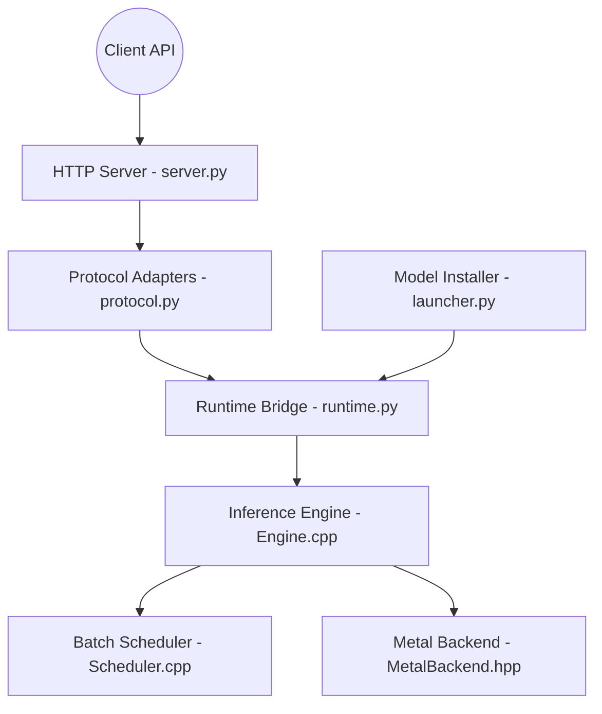

# incoai/splash

> Moteur d'inférence local pour Mac Apple silicon, compatible API OpenAI et Anthropic, avec décodage spéculatif.

## Le problème
Faire tourner un agent de code sur un modèle local à une vitesse utilisable reste lent sur Mac avec llama.cpp.

## Ce que ça fait vraiment
Associe à chaque famille de modèles (Qwen3.8-27B, Qwen3.6-35B-A3B, etc.) un brouillon DFlash2 et des noyaux Metal dédiés, avec planification mémoire automatique. Sert Chat Completions, Responses, Completions et Messages, avec streaming, outils, sortie JSON Schema, images et PDF. Mutualise les préfixes en cache et regroupe les requêtes concurrentes. Lance `opencode`, `claude`, `codex`, `hermes` ou `pi` en une commande.

## Comment c'est branché


## Essayer
```bash
brew install incoai/tap/splash
splash serve --model unsloth/Qwen3.8-27B-GGUF:UD-Q4_K_M
splash opencode
curl http://127.0.0.1:8000/v1/chat/completions -H 'Content-Type: application/json' \
  -d '{"model": "unsloth/Qwen3.8-27B-GGUF:UD-Q4_K_M", "messages": [{"role": "user", "content": "Explain speculative decoding in one sentence."}]}'
```

## Coût et pièges
Mac M3 ou plus récent, macOS 26.4+, Homebrew. Téléchargement du modèle et de son brouillon au premier lancement. Les modèles de 24 Go de RAM exigent des variantes plus petites. Le serveur écoute en localhost sans authentification par défaut. Les chiffres de performance viennent du README, mesurés sur M5 Pro.

## Ce que ce n'est pas
Pas multi-plateforme : uniquement Apple silicon. Les modèles BF16 ou F16 entiers ne sont pas pris en charge. Les poids gardent leur propre licence.

## Alternatives
- llama.cpp : multi-plateforme ; le README le cite comme référence de vitesse (Splash annonce 2,5 à 5,3 fois plus rapide).

## Pour toi
Valable si tu sers des LLM sur Mac pour des agents de code ; à surveiller et à mesurer sur ton modèle avant d'y croire.

