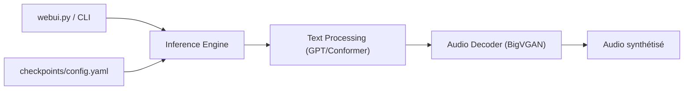

# index-tts/index-tts

> Zero-shot speech synthesis that clones a voice from a single sample, with emotion and pronunciation control.

## The problem
Cloning a voice and controlling emotion, speed and pronunciation often requires several models or training data.

## What it actually does
IndexTTS-2.5 (Chinese, English, Japanese, Spanish, Arabic) clones a voice from a reference audio. Emotion is controlled by audio, an 8-value vector or text; duration (`duration_factor`) and pronunciation (Pinyin, CMU phonemes, Kana) are controllable too. The README publishes WER/similarity tables and a real-time factor of 0.2 on an RTX 4090. Web interface, Python API and a vLLM recipe.

## How it is wired


## Trying it
```bash
git clone https://github.com/index-tts/index-tts.git && cd index-tts
uv sync --all-extras
hf download IndexTeam/IndexTTS-2.5 --local-dir=checkpoints
uv run webui.py
```

## Cost and gotchas
An NVIDIA GPU (CUDA 12.8+) is recommended. Models are downloaded from Hugging Face or ModelScope. A license is present but not identified by GitHub: read it before any commercial use.

## What it is not
It is not a ready-to-use hosted service. Voice cloning raises consent questions that the README does not address.

## Alternatives
No alternative named in the README (the table compares VoxCPM2, OmniVoice, CosyVoice3, Fish Audio S2 Pro, Qwen3-TTS…).

## For you
Keep an eye on it: interesting for prototyping multilingual TTS locally, but the license needs clarifying and a GPU is required.
