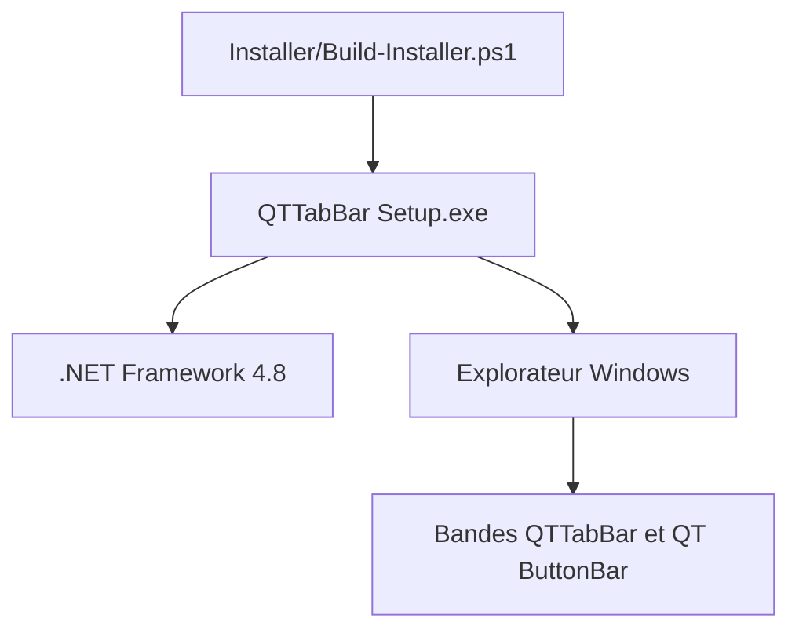

# indiff/qttabbar

> Windows Explorer extension that adds tabs and other features, version updated for .NET 4.8.

## The problem
Windows Explorer, long without tabs, slows down anyone who opens several folders.

## What it actually does
QTTabBar adds tabs, hover previews of text and media files, and other toolbars in Explorer. On Windows 11, it is enabled through an experimental option (Explorer restart) and coexists with the native tabs. This repository is a derived version of the original 2012 SourceForge release, with additions for Chinese users.

## How it is wired
Simplified diagram based on the sheet, no diagram provided.



## Trying it
```bash
msbuild QTTabBar\QTTabBar.csproj /p:Configuration=Release /p:SolutionDir="$pwd\\"
.\Installer\Build-Installer.ps1 -Version 1.5.6.4
```

## Cost and gotchas
Free (GPL-3.0). Windows only; build with Visual Studio 2022 and WiX 3.14. Activation on Windows 11 is experimental. Docs and community mostly in Chinese.

## What it is not
Not a full file manager: it extends Explorer. Not cross-platform.

## Alternatives
No alternative cited in the README (the original SourceForge version is mentioned).

## For you
Ignore: a tweak of Windows Explorer, outside the data, AI and MLOps scope.
