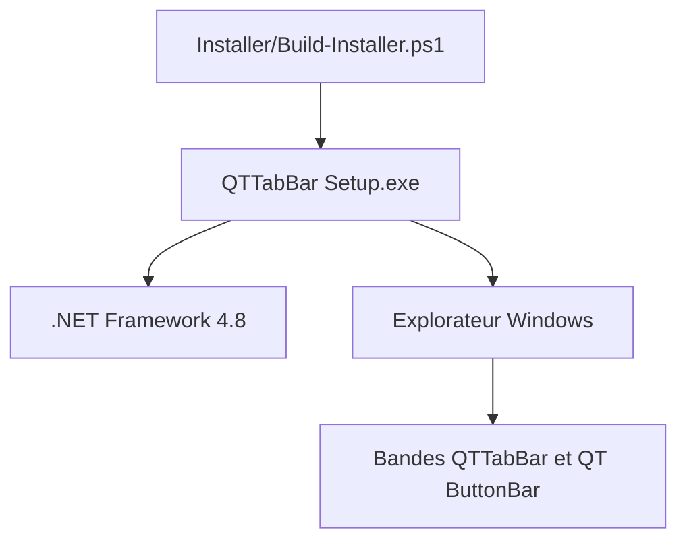

# indiff/qttabbar

> Extension de l'Explorateur Windows qui ajoute des onglets et d'autres fonctions, version mise à jour pour .NET 4.8.

## Le problème
L'Explorateur Windows, longtemps sans onglets, ralentit quiconque ouvre plusieurs dossiers.

## Ce que ça fait vraiment
QTTabBar ajoute des onglets, des aperçus au survol de fichiers texte et médias, et d'autres bandes d'outils dans l'Explorateur. Sous Windows 11, il s'active par une option expérimentale (redémarrage de l'Explorateur) et cohabite avec les onglets natifs. Ce dépôt est une version dérivée de l'original SourceForge de 2012, avec des ajouts pour les utilisateurs chinois.

## Comment c'est branché
Schéma simplifié d'après la fiche, sans diagramme fourni.



## Essayer
```bash
msbuild QTTabBar\QTTabBar.csproj /p:Configuration=Release /p:SolutionDir="$pwd\\"
.\Installer\Build-Installer.ps1 -Version 1.5.6.4
```

## Coût et pièges
Gratuit (GPL-3.0). Windows seulement ; compilation avec Visual Studio 2022 et WiX 3.14. L'activation sous Windows 11 est expérimentale. Doc et communauté surtout en chinois.

## Ce que ce n'est pas
Pas un gestionnaire de fichiers complet : il étend l'Explorateur. Pas multiplateforme.

## Alternatives
Aucune alternative citée dans le README (la version SourceForge d'origine est mentionnée).

## Pour toi
À ignorer : retouche de l'Explorateur Windows, hors périmètre data, IA et MLOps.

