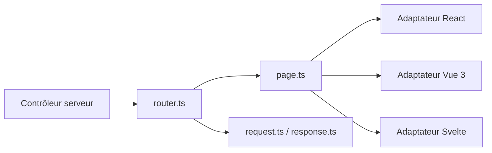

# inertiajs/inertia

> Glues a backend (Laravel, Rails…) to a React, Vue or Svelte front end without writing an API.

## The problem
Building an SPA usually forces you to build an API and duplicate routing and validation on the client side.

## What it actually does
The server controller returns a page component with its data; Inertia handles navigation without a full reload. Forms, file uploads, partial reloads, prefetching, server-side rendering and DevTools are included. React/Vue/Svelte adapters live in this repository; Laravel is official, other servers are community-maintained.

## How it is wired


## Trying it
```bash
# Pas de commande d'installation dans le README ; voir la documentation officielle
```

## Cost and gotchas
Free. The README pushes Laravel Cloud (Starter at $5/month) for deployment: optional.

## What it is not
Neither a full framework nor a replacement for React/Vue: you need a compatible backend. Not a tool for notebooks or pipelines.

## Alternatives
No alternative named in the README.

## For you
Ignore: useful for full-stack web, outside the data/AI/MLOps scope.
