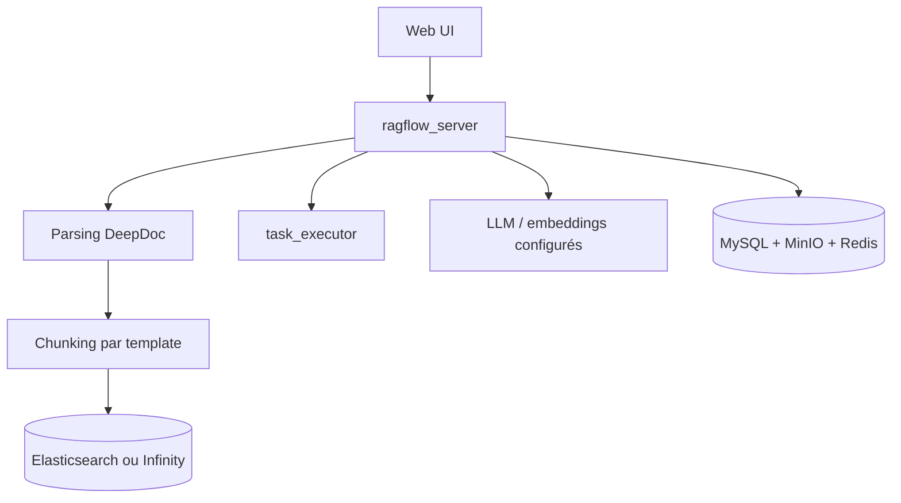

# infiniflow/ragflow

> RAG (Retrieval-Augmented Generation) engine, self-hosted, based on deep understanding of documents, with agent capabilities.

## The problem
A naive RAG system blindly extracts documents and produces inconsistent excerpts from complex PDFs.
Building a complete pipeline (parsing, chunking, indexing, reranking, orchestration) takes weeks.

## What it actually does
Template-based cutting, described as being easy to understand and configurable depending on the type of document.
Supports Word, slides, Excel, TXT, images, scanned copies, structured data, and web pages.
Multiple recall with merged re-ranking; configurable LLM and embedding models.
Switchable document engine between Elasticsearch (default) and Infinity via `DOC_ENGINE`.

## How it is wired


## Trying it
```bash
git clone https://github.com/infiniflow/ragflow.git
cd ragflow/docker && git checkout v0.27.2
docker compose -f docker-compose.yml up -d
docker logs -f docker-ragflow-cpu-1
```

## Cost and gotchas
The software is free; the LLM keys are your responsibility, and a paid cloud service is available.

Requires 4 cores, 16 GB of RAM, 50 GB of disk space, `vm.max_map_count ≥ 262144`, and gVisor for the code sandbox.

## What it is not
Not lightweight: the entire stack requires MySQL, MinIO, Redis, and Elasticsearch in addition to the service.
The Docker images are only compatible with x86 architecture – they need to be rebuilt for ARM64.
Switching to Infinity will erase existing volumes and is not officially supported on Linux/arm64.

## Alternatives
- `microsoft/markitdown`: if only Markdown conversion is required.
- `PaddlePaddle/PaddleOCR`: A document parsing building block, without the surrounding RAG engine.

## For you
The most comprehensive, all-in-one RAG solution from the group, but also the heaviest. It should be evaluated against a home-built solution.
