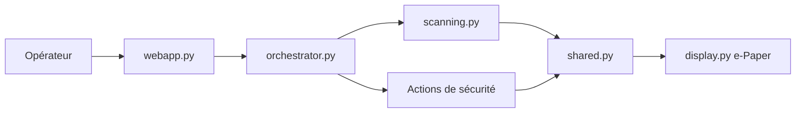

# infinition/Bjorn

> Autonomous network reconnaissance tool for Raspberry Pi with an e-Paper display, for authorized security teams.

## The problem
Regularly auditing a network you administer requires dedicated hardware and scattered scripts. Bjorn bundles them into a small standalone device.

## What it actually does
An orchestrator (`orchestrator.py`) chains configurable actions: host and port discovery (`scanning.py`), vulnerability assessment, credential tests on services, then data collection. Each child action depends on the success of the parent action. State is shared (`shared.py`) and shown on the e-Paper display (`display.py`) and through a web interface (`webapp.py`). The README announces modules that the community can add. Results are stored in `data/output/`.

## How it is wired


## Trying it
```bash
wget https://raw.githubusercontent.com/infinition/Bjorn/refs/heads/main/install_bjorn.sh
sudo chmod +x install_bjorn.sh && sudo ./install_bjorn.sh
```
README prerequisites: Raspberry Pi OS (Debian 12 bookworm), user and hostname `bjorn`, 2.13-inch e-Paper display (V2 and V4 versions tested).

## Cost and gotchas
Free, but you need a Raspberry Pi Zero W/W2 and the display. Installation is long and requires a reboot. Use is only lawful on networks you own or for which you have written authorization: the README itself states "educational and authorized testing only".

## What it is not
Not a passive monitoring tool: it acts on the network (authentication tests, collection). The README demo is declared fictional. Support for the 64-bit Pi Zero W2 relies on user feedback, not dedicated development.

## Alternatives
- infinition/bjorn-detector: mentioned by the README for finding the device's IP after installation (companion, not a substitute).

## For you
Keep an eye on it: security tinkering project, unrelated to a data/AI/MLOps workflow; consider it only for a supervised personal network lab.
