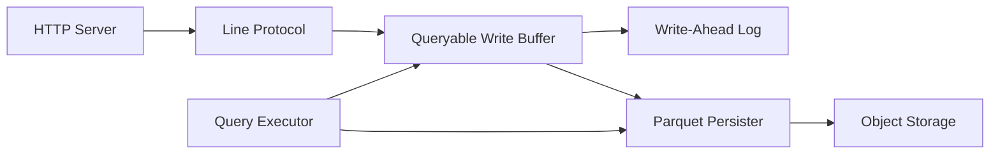

# influxdata/influxdb

> InfluxDB 3 Core time-series database in Rust, for monitoring and real-time event analytics.

## The problem
Ingesting metrics and events at high throughput while answering dashboard queries quickly.

## What it actually does
InfluxDB 3 Core is written in Rust on Apache Arrow and DataFusion: line-protocol writes (compatible with the 1.x and 2.x APIs), in-memory buffer and WAL, persistence in Parquet on local disk or object storage (S3, Azure, GCP). Queries in SQL, InfluxQL and FlightSQL. An embedded Python virtual machine runs plugins and triggers. Responses advertised under 10 ms for the latest values. The repository also contains the older versions on other branches.

## How it is wired

## Trying it
No commands in the README: Docker, deb, rpm packages and tarballs are on InfluxData's download page. HTTP API on port 8181.

## Cost and gotchas
Core is free, Enterprise is paid. Available only since April 2025. Versions 1.x and 2.x live on other branches, and Flux is gone in v3.

## What it is not
Not a visualization tool nor an alerting system: you need to plug in Grafana or equivalent. The advertised performance is not detailed in the README.

## Alternatives
No alternative is cited in the README.

## For you
Watch: relevant for storing model or MLOps pipeline telemetry, with Parquet and SQL making it easy to take the data elsewhere.
