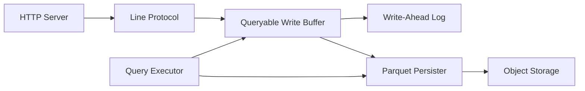

# influxdata/influxdb

> Base de séries temporelles InfluxDB 3 Core en Rust, pour monitoring et analyses d'événements en temps réel.

## Le problème
Ingérer des métriques et événements à haut débit tout en répondant vite aux requêtes de tableaux de bord.

## Ce que ça fait vraiment
InfluxDB 3 Core écrit en Rust sur Apache Arrow et DataFusion : écritures par protocole ligne (compatibles API 1.x et 2.x), tampon en mémoire et WAL, persistance en Parquet sur disque local ou stockage objet (S3, Azure, GCP). Requêtes en SQL, InfluxQL et FlightSQL. Une machine virtuelle Python embarquée exécute plugins et déclencheurs. Réponses annoncées sous 10 ms pour les dernières valeurs. Le dépôt contient aussi les anciennes versions sur d'autres branches.

## Comment c'est branché

## Essayer
Aucune commande dans le README : paquets Docker, deb, rpm et tarballs sur la page de téléchargement d'InfluxData. API HTTP sur le port 8181.

## Coût et pièges
Core gratuit, Enterprise payant. Disponible depuis avril 2025 seulement. Les versions 1.x et 2.x vivent sur d'autres branches, avec Flux en moins dans la v3.

## Ce que ce n'est pas
Pas un outil de visualisation ni un système d'alerte : il faut y brancher Grafana ou équivalent. Les performances annoncées ne sont pas détaillées dans le README.

## Alternatives
Aucune alternative citée dans le README.

## Pour toi
À surveiller : pertinent pour stocker de la télémétrie de modèles ou de pipelines MLOps, Parquet et SQL facilitant la reprise des données ailleurs.

