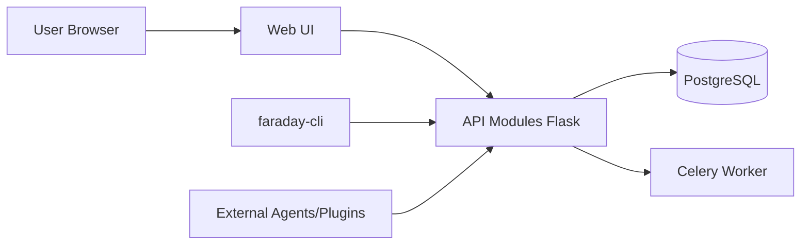

# infobyte/faraday

> Multi-user platform that centralizes and normalizes vulnerability scanner results, for security teams.

## The problem
Results from many audit tools are scattered across different formats; tracking remediation becomes hard to share.

## What it actually does
Server that aggregates and normalizes results from more than 80 tools via plugins ("console" type that interpret an output, or "report" type that import XML/JSON). They are stored in PostgreSQL and presented in a web interface with visualizations. A `faraday-cli` client and remote agents (Agents Dispatcher) allow automating and launching tools remotely. Use assumes you are authorized to audit the targets.

## How it is wired


## Trying it
```bash
wget https://raw.githubusercontent.com/infobyte/faraday/master/docker-compose.yaml
docker-compose up
pip3 install faradaysec
faraday-manage initdb
faraday-server
pip3 install faraday-cli
faraday-cli tool report burp.xml
```

## Cost and gotchas
Free. A PostgreSQL is needed (provided by the compose file, otherwise to be set up). The initial password is given at installation, interface on port 5985.

## What it is not
It is not a scanner: it organizes the results of third-party tools and discovers none itself. GPL-3.0 license (copyleft). The README details neither limits nor pricing of a possible commercial offering.

## Alternatives
No alternative named in the README; it cites tools it integrates (Nmap, Burp, OWASP ZAP, SonarQube, Bandit).

## For you
Worth watching: useful only if your team does regular security audits; outside that scope, a data/AI profile will get nothing from it.
