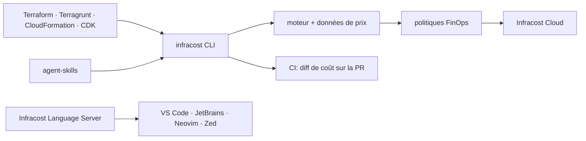

# infracost/infracost

> Cloud cost estimation and FinOps policies from the terminal, the editor, the AI agent and CI.

## The problem
The cost of an infrastructure change only shows up on the bill, a month after the pull request is merged.

## What it actually does
The CLI analyzes a Terraform, Terragrunt, CloudFormation or AWS CDK project and returns a full cost breakdown and FinOps recommendations; `infracost inspect` details the resources and cost drivers. `infracost setup` wires up authentication, the editor, AI agent skills and CI in one pass. Three skills exist for Claude Code, Cursor and similar: `iac-generation` (keeping generated IaC compliant with tag, region and budget policies), `scan` and `price-lookup`. The editor extensions (VS Code, JetBrains, Neovim, Zed) display cost lenses, inline hints and diagnostics, all powered by the Infracost Language Server — so usable by any editor that speaks LSP. CI publishes cost diffs and policy checks on PRs.

## How it is wired


## Trying it
```sh
brew install infracost
curl -fsSL https://raw.githubusercontent.com/infracost/cli/master/scripts/install.sh | sh
choco install infracost
infracost setup
infracost scan
```

## Cost and gotchas
The CLI requires authentication via `infracost setup`, hence an account. Tag policies and guardrails are defined in Infracost Cloud, the SaaS dashboard: it is what keeps the CLI, editors, skills and CI consistent. The Linux install goes through a `curl | sh`.

## What it is not
It is not a real billing tool: it estimates from price data and your code, not from your observed consumption. Moreover, this repository is no longer the code — since Infracost 2.0, the codebase was split into dedicated repositories (`infracost/cli`, `infracost/agent-skills`, extensions); this one is the front door, for issues and general discussions.

## Alternatives
No external alternative is named; the README only lists components of the same ecosystem.

## For you
The `price-lookup` skill alone is worth the detour for pricing a GPU instance before provisioning it; the rest assumes your team adopts Infracost Cloud.
