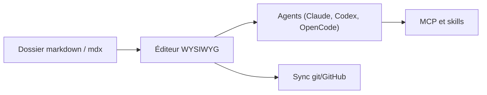

# inkeep/open-knowledge

> Local WYSIWYG markdown editor that integrates with Claude, Codex and other agents, for wikis and notes.

## The problem
AI agents work on markdown files, but there is no comfortable editor that also gives them search and tools.

## What it actually does
Desktop application (macOS, Windows, Linux) or local web interface, with file browser, search, tabs and wiki-link graph. It edits side by side with an agent and installs MCP and skills for the detected agents. Team sharing goes through git/GitHub.

## How it is wired

Simplified diagram based on the sheet, no diagram provided.

## Trying it
```bash
npm install -g @inkeep/open-knowledge
cd your-project
ok init
ok start --open
```

## Cost and gotchas
Free. Node.js 24 and git are required for the web version. The connected agents (Claude, Codex) have their own costs. GPL-3.0 license, restrictive if you want to reuse the code.

## What it is not
It is not a model or an agent: it is the editor and its MCP plumbing. It does not replace a server-side knowledge base tool.

## Alternatives
No alternative named in the README.

## For you
Keep an eye on it: useful if you keep a wiki or a second brain in markdown with agents, but the project is five months old and its license is copyleft.
