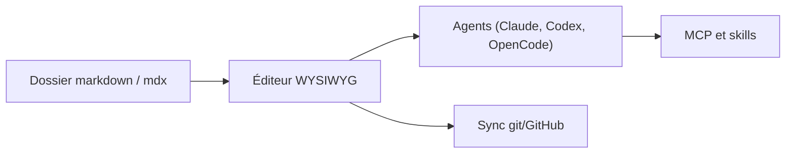

# inkeep/open-knowledge

> Éditeur markdown WYSIWYG local qui s'intègre à Claude, Codex et autres agents, pour wikis et notes.

## Le problème
Les agents d'IA travaillent sur des fichiers markdown, mais on manque d'un éditeur confortable qui leur donne aussi recherche et outils.

## Ce que ça fait vraiment
Application de bureau (macOS, Windows, Linux) ou interface web locale, avec navigateur de fichiers, recherche, onglets et graphe de liens wiki. Elle édite en côte à côte avec un agent et installe MCP et skills pour les agents détectés. Le partage d'équipe passe par git/GitHub.

## Comment c'est branché

Schéma simplifié d'après la fiche, sans diagramme fourni.

## Essayer
```bash
npm install -g @inkeep/open-knowledge
cd your-project
ok init
ok start --open
```

## Coût et pièges
Gratuit. Node.js 24 et git requis pour la version web. Les agents branchés (Claude, Codex) ont leurs propres coûts. Licence GPL-3.0, contraignante pour une reprise du code.

## Ce que ce n'est pas
Ce n'est pas un modèle ni un agent : c'est l'éditeur et sa plomberie MCP. Il ne remplace pas un outil de base de connaissances serveur.

## Alternatives
Aucune alternative nommée dans le README.

## Pour toi
À surveiller : utile si tu tiens un wiki ou un second cerveau en markdown avec des agents, mais le projet a cinq mois et sa licence est copyleft.

