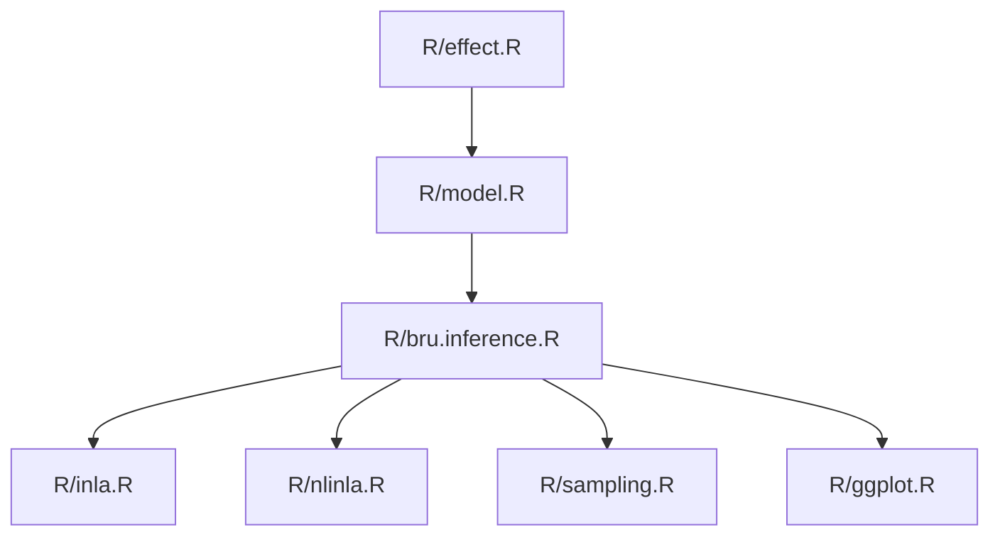

# inlabru-org/inlabru

> R package for Bayesian spatial modelling with INLA, including log-Gaussian Cox processes.

## The problem
Modelling spatial ecological data with INLA takes a lot of code and does not handle non-linear predictors.

## What it actually does
`bru()` assembles latent components and likelihoods, then calls INLA, with iterative linearisation (`nlinla.R`) for non-linear predictors. `predict()` is done by Monte Carlo sampling. The README example fits an LGCP on gorilla nests and plots the intensity with ggplot.

## How it is wired
Diagram based on the code diagram.



## Trying it
```bash
# Dans R :
# options(repos = c(INLA = "https://inla.r-inla-download.org/R/testing", getOption("repos")))
# install.packages("inlabru")
# pak::pak("inlabru-org/inlabru")
```

## Cost and gotchas
Free. Depends on R-INLA, which is outside CRAN. No license declared in the catalogue.

## What it is not
Not a general machine learning package: a spatial Bayesian statistics tool.

## Alternatives
None cited in the README.

## For you
Keep an eye on it: a reference if you do spatial Bayesian statistics in R, otherwise off topic.
