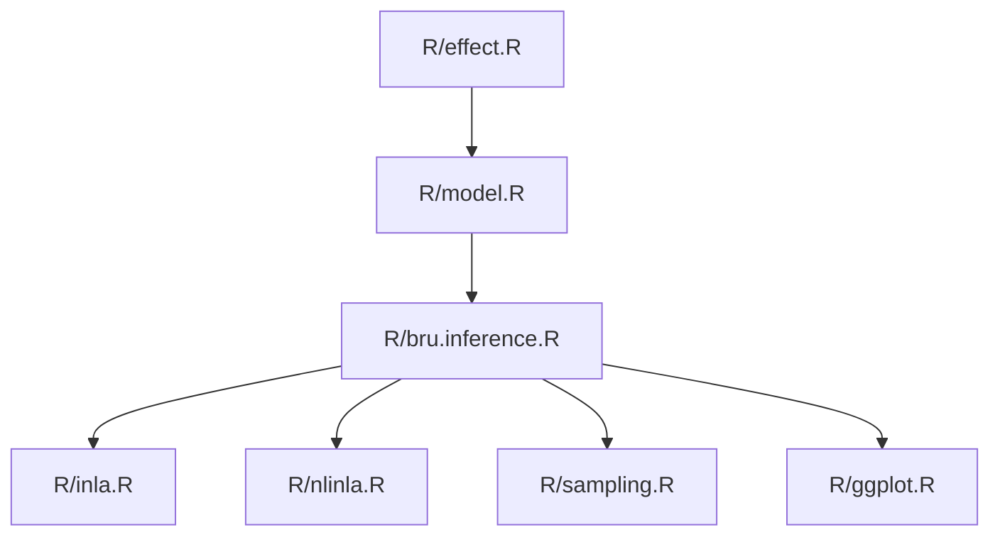

# inlabru-org/inlabru

> Paquet R de modélisation spatiale bayésienne par INLA, avec processus de Cox log-gaussiens.

## Le problème
Modéliser des données écologiques spatiales avec INLA demande beaucoup de code et ne gère pas les prédicteurs non linéaires.

## Ce que ça fait vraiment
`bru()` assemble des composants latents et des vraisemblances, puis appelle INLA, avec linéarisation itérative (`nlinla.R`) pour les prédicteurs non linéaires. `predict()` se fait par échantillonnage de Monte Carlo. L'exemple du README ajuste un LGCP sur des nids de gorilles et trace l'intensité avec ggplot.

## Comment c'est branché
Schéma d'après le diagramme du code.



## Essayer
```bash
# Dans R :
# options(repos = c(INLA = "https://inla.r-inla-download.org/R/testing", getOption("repos")))
# install.packages("inlabru")
# pak::pak("inlabru-org/inlabru")
```

## Coût et pièges
Gratuit. Dépend de R-INLA, hors CRAN. Aucune licence déclarée dans le catalogue.

## Ce que ce n'est pas
Pas un paquet d'apprentissage automatique général : un outil de statistique bayésienne spatiale.

## Alternatives
Aucune citée dans le README.

## Pour toi
Surveiller : référence si tu fais de la statistique spatiale bayésienne en R, sinon hors sujet.

