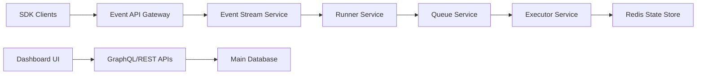

# inngest/inngest

> Durable functions platform: jobs, step-based workflows and scheduling without managing queues.

## The problem
Reliable background tasks require queues, state, retries and cron assembled by hand, with a lot of infrastructure.

## What it actually does
You write functions with an SDK (TypeScript, Python, Go, Kotlin): trigger (event, cron, webhook), flow control, steps.
Each `step.run` is replayed and retried independently; runs can last for months.
The server (Event API, Runner, Queue, Executor, State store) invokes your functions over HTTPS.
Local dev server with a dashboard; self-hosting possible.

## How it is wired


## Trying it
```bash
npx inngest-cli@latest dev
```
Then open http://localhost:8288.

## Cost and gotchas
The server is free when self-hosted; the hosted platform is a commercial service. License not identified by GitHub, to be read before use.

## What it is not
Not a simple message queue: it imposes its step-function model and calls your code over HTTP.

## Alternatives
No alternative named in the README.

## For you
Worth watching: serious for orchestrating long, retryable LLM pipelines with the Python SDK, subject to validating the license.
