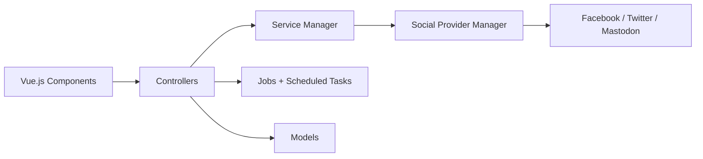

# inovector/mixpost

> Self-hosted social media management platform: scheduling, calendar, teams and analytics.

## The problem
Publishing on several networks means juggling platforms, with no unified calendar or teamwork.

## What it actually does
Laravel package with a Vue interface: grouped social accounts, scheduling and queue, per-network post versions, templates, hashtag groups, media library (Unsplash, Tenor), workspaces. Facebook, Twitter and Mastodon providers according to the diagram. Pro and Enterprise features are separated in `src/Components/Pro`.

## How it is wired

## Trying it
No command in the README: it points to the installation documentation.

## Cost and gotchas
The free version is limited; Pro and Enterprise are paid (prices not stated). Access to the networks' APIs is subject to their terms. Last push in March 2026.

## What it is not
Not a complete free tool: advanced features are behind the paid plan. Does not bypass the social APIs' restrictions.

## Alternatives
No alternative named in the README.

## For you
Ignore: social marketing unrelated to data/AI; the open core also forces a paid upgrade.
