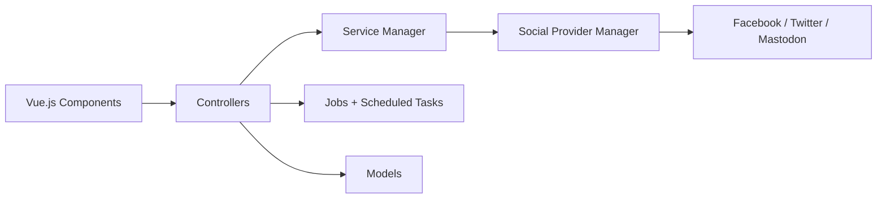

# inovector/mixpost

> Plateforme auto-hébergée de gestion des réseaux sociaux : planification, calendrier, équipes et analytics.

## Le problème
Publier sur plusieurs réseaux demande de jongler entre plateformes, sans calendrier ni travail d'équipe unifiés.

## Ce que ça fait vraiment
Package Laravel avec interface Vue : comptes sociaux regroupés, planification et file d'attente, versions de publications par réseau, modèles, groupes de hashtags, bibliothèque de médias (Unsplash, Tenor), espaces de travail. Fournisseurs Facebook, Twitter et Mastodon d'après le diagramme. Des fonctions Pro et Enterprise sont séparées dans `src/Components/Pro`.

## Comment c'est branché

## Essayer
Aucune commande dans le README : renvoi à la documentation d'installation.

## Coût et pièges
La version libre est limitée ; Pro et Enterprise sont payantes (prix non indiqués). Accès aux API des réseaux soumis à leurs conditions. Dernier push en mars 2026.

## Ce que ce n'est pas
Pas un outil complet gratuit : fonctions avancées derrière le plan payant. Ne contourne pas les restrictions des API sociales.

## Alternatives
Aucune alternative nommée dans le README.

## Pour toi
Ignorer : marketing social sans lien avec data/IA ; l'open core impose en plus une montée en gamme payante.

