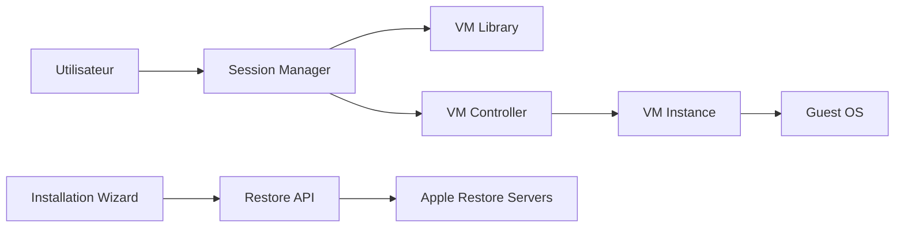

# insidegui/VirtualBuddy

> Virtualizes macOS on Apple Silicon to test applications on several system versions, betas included.

## The problem
Testing an application on several macOS versions requires multiple machines or installations.

## What it actually does
Installation wizard that downloads a macOS version from Apple's servers or uses a local IPSW or a URL. It also handles ARM Linux distributions (Ubuntu tested), recovery mode, networking, file and clipboard sharing, and saving a VM's state. A "guest" app handles the clipboard and automatic mounting of shared folders. APFS cloning lets you duplicate a VM at low disk cost.

## How it is wired


## Trying it
To run in the VM's terminal, to mount a shared folder:
```bash
mkdir -p ~/Desktop/VirtualBuddyShared && mount -t virtiofs VirtualBuddyShared ~/Desktop/VirtualBuddyShared
```

## Cost and gotchas
Free (Gumroad purchase or sponsorship optional). Apple Silicon, macOS 13+. To build: Xcode 16 and a unique bundle ID. Betas require Apple's device support files.

## What it is not
It is not an x86 tool or a general-purpose hypervisor: it relies on Apple virtualization, on Apple Silicon Macs only. The guest client is unavailable before macOS 13 for the clipboard.

## Alternatives
No alternative named in the README.

## For you
Ignore: Apple app testing tool, unless you need to isolate macOS environments for CI tests; nothing specific to data/AI.
