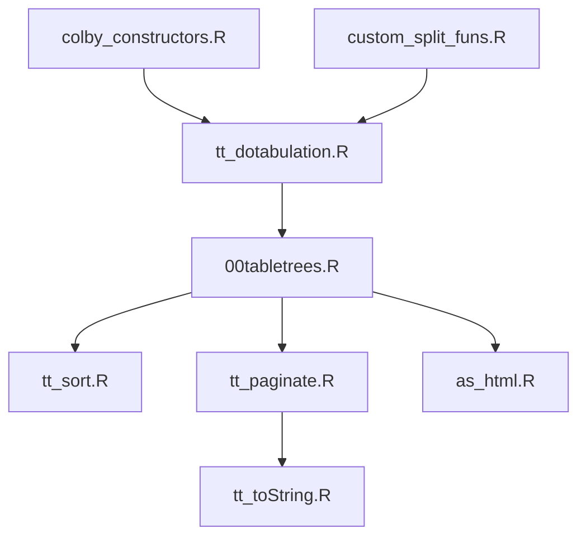

# insightsengineering/rtables

> R package for building complex reporting tables, notably for clinical regulatory submissions.

## The problem
Clinical trial tables require accessible unrounded values, several values per cell and fine-grained pagination.

## What it actually does
You describe the layout with splits (split_cols_by, split_rows_by) and analysis functions, then build_table produces a table tree. It can be sorted, paginated and exported to text, HTML, PDF or PowerPoint; rtf is under development.

## How it is wired


## Trying it
```r
install.packages("rtables")
library(rtables)
lyt <- basic_table() |> split_cols_by("ARM") |> analyze("AGE")
build_table(lyt, ex_adsl)
```

## Cost and gotchas
Free. The README states an Apache 2 license from Roche, but the catalog sees it as unidentified.

## What it is not
Not a spreadsheet or a charting engine: a reporting-table engine.

## Alternatives
No alternative named in the README.

## For you
Worth watching: useful if you produce reporting tables in R, notably for pharma.
