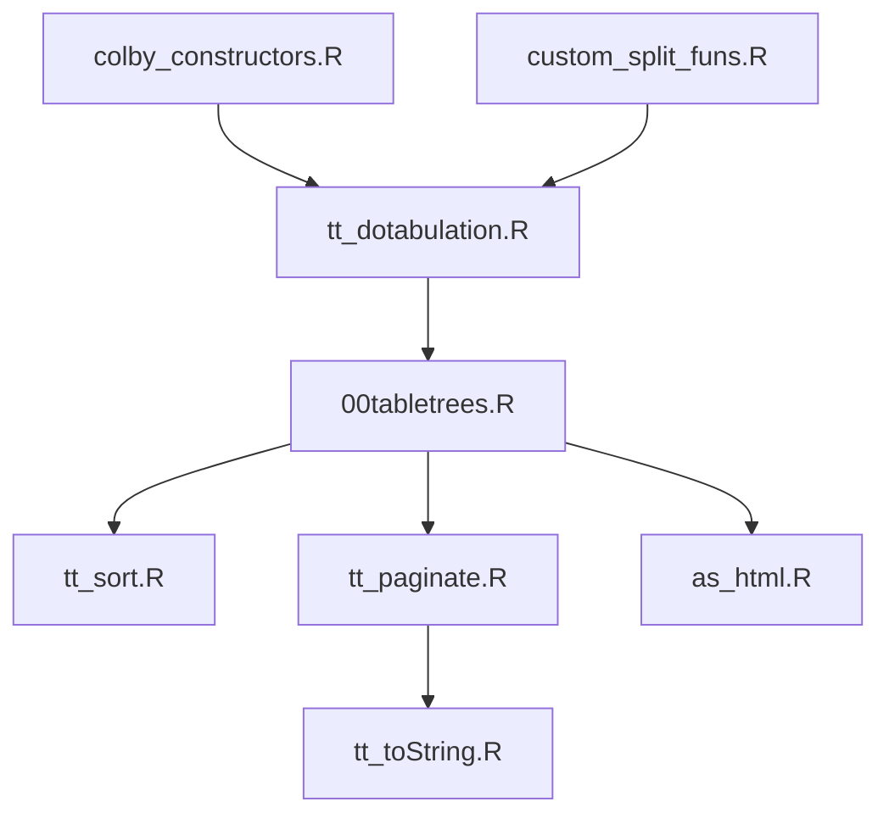

# insightsengineering/rtables

> Package R pour créer des tableaux de rapport complexes, notamment pour les soumissions réglementaires cliniques.

## Le problème
Les tableaux d'essais cliniques exigent des valeurs non arrondies accessibles, plusieurs valeurs par cellule et une pagination fine.

## Ce que ça fait vraiment
On décrit la mise en page par des découpages (split_cols_by, split_rows_by) et des fonctions d'analyse, puis build_table produit un arbre de tableau. On peut le trier, le paginer et l'exporter en texte, HTML, PDF ou PowerPoint ; rtf est en développement.

## Comment c'est branché


## Essayer
```r
install.packages("rtables")
library(rtables)
lyt <- basic_table() |> split_cols_by("ARM") |> analyze("AGE")
build_table(lyt, ex_adsl)
```

## Coût et pièges
Gratuit. Le README annonce une licence Apache 2 de Roche, mais le catalogue la voit comme non identifiée.

## Ce que ce n'est pas
Pas un tableur ni un moteur de graphiques : un moteur de tableaux de reporting.

## Alternatives
Aucune alternative nommée dans le README.

## Pour toi
À surveiller : utile si tu produis des tableaux de reporting en R, notamment pour la pharma.

