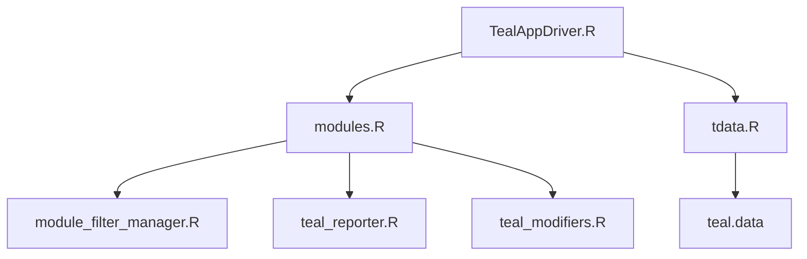

# insightsengineering/teal

> R Shiny framework for building data exploration applications, notably for clinical trials.

## The problem
Every team rewrites its exploratory Shiny applications, redoing filters, reports and reproducibility.

## What it actually does
You supply data (CDISC, linked tables, multi-omics objects) and Shiny modules. The framework adds a filter panel, a data summary, bookmarks, snapshots, report generation and reproducible code through the teal.slice, teal.code and teal.reporter packages.

## How it is wired


## Trying it
```r
install.packages("teal")
library(teal)
app <- init(data = teal_data(iris = iris), modules = list(module(label = "iris histogram", server = function(input, output, session, data) {}, ui = function(id) {})))
shinyApp(app$ui, app$server)
```

## Cost and gotchas
Free. You need to master Shiny; the ecosystem has many teal.* packages. License present but not identified by GitHub.

## What it is not
Not a no-code tool: a framework for R developers. Developed by Roche and Appsilon.

## Alternatives
No alternative named in the README.

## For you
Worth watching: keep in mind if you deliver R dashboards in pharma, otherwise outside your scope.
