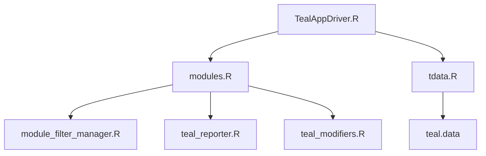

# insightsengineering/teal

> Cadre Shiny en R pour bâtir des applications d'exploration de données, notamment d'essais cliniques.

## Le problème
Chaque équipe réécrit ses applications Shiny d'exploration, avec filtres, rapports et reproductibilité à refaire.

## Ce que ça fait vraiment
On fournit des données (CDISC, tables liées, objets multi-omiques) et des modules Shiny. Le cadre ajoute panneau de filtres, résumé des données, marque-pages, instantanés, génération de rapports et code reproductible via les paquets teal.slice, teal.code et teal.reporter.

## Comment c'est branché


## Essayer
```r
install.packages("teal")
library(teal)
app <- init(data = teal_data(iris = iris), modules = list(module(label = "iris histogram", server = function(input, output, session, data) {}, ui = function(id) {})))
shinyApp(app$ui, app$server)
```

## Coût et pièges
Gratuit. Il faut maîtriser Shiny ; l'écosystème compte de nombreux paquets teal.*. Licence présente mais non identifiée par GitHub.

## Ce que ce n'est pas
Pas un outil sans code : un cadre pour développeurs R. Développé par Roche et Appsilon.

## Alternatives
Aucune alternative nommée dans le README.

## Pour toi
À surveiller : à retenir si tu livres des tableaux de bord R en pharma, sinon hors de ton périmètre.

