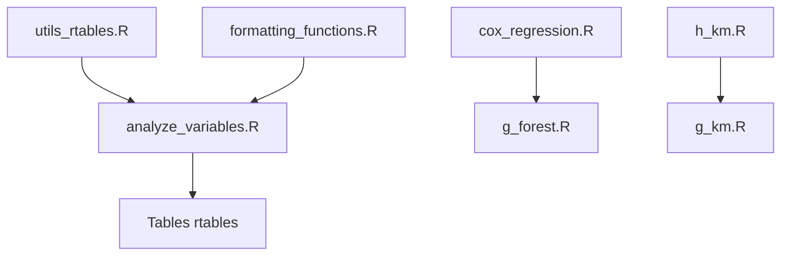

# insightsengineering/tern

> R package of functions to produce tables and graphs for clinical trial reports.

## The problem
Clinical trial reports require many standardized tables and graphs, written case by case.

## What it actually does
Graphs: line plots, Kaplan-Meier, forest plots, STEP, individual patient, waterfall, Bland-Altman. Model summaries: logistic and Cox regressions. Analysis tables built with `rtables`. Several outputs plug into `teal` applications via `teal.modules.clinical`.

## How it is wired


## Trying it
```bash
# commandes R du README :
# install.packages("tern")
# pak::pak("pharmaverse/tern")
```

## Cost and gotchas
Free, on CRAN. License not identified by GitHub. Requires knowing `rtables`; getting started goes through the vignettes.

## What it is not
Not a general-purpose statistics tool: oriented toward clinical trials.

## Alternatives
No alternative named in the README.

## For you
Watch: interesting if you produce clinical statistical reports in R, useless otherwise.
