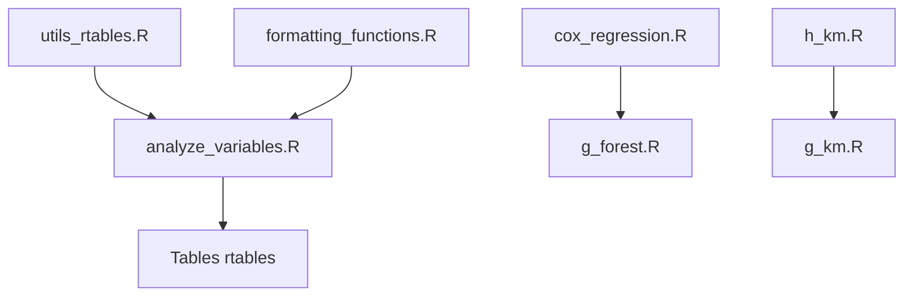

# insightsengineering/tern

> Paquet R de fonctions pour produire tables et graphiques de rapports d'essais cliniques.

## Le problème
Les rapports d'essais cliniques demandent beaucoup de tables et de graphiques normalisés, écrits au cas par cas.

## Ce que ça fait vraiment
Graphiques : lignes, Kaplan-Meier, forest plots, STEP, patient individuel, cascade, Bland-Altman. Résumés de modèles : régressions logistique et de Cox. Tables d'analyse construites avec `rtables`. Plusieurs sorties s'intègrent aux applications `teal` via `teal.modules.clinical`.

## Comment c'est branché


## Essayer
```bash
# commandes R du README :
# install.packages("tern")
# pak::pak("pharmaverse/tern")
```

## Coût et pièges
Gratuit, sur CRAN. Licence non identifiée par GitHub. Demande de connaître `rtables` ; la prise en main passe par les vignettes.

## Ce que ce n'est pas
Pas un outil généraliste de statistiques : orienté essais cliniques.

## Alternatives
Aucune alternative nommée dans le README.

## Pour toi
Surveiller : intéressant si tu fais des rapports statistiques cliniques en R, inutile sinon.

