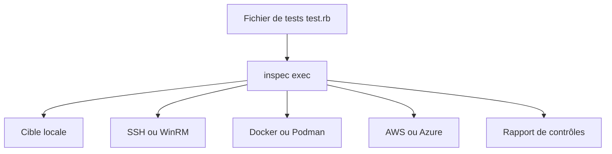

# inspec/inspec

> Ruby infrastructure testing framework for expressing compliance and security rules.

## The problem
Compliance is checked late, by hand, without executable rules on servers and containers.

## What it actually does
You write controls in Ruby (`describe package('telnetd')`) and InSpec runs them locally or on a remote target: SSH, WinRM, Docker, Podman, AWS, Azure. It provides shareable profiles, impact metadata, and an `inspec detect` command.

## How it is wired
Simplified diagram based on the fiche, no diagram provided.



## Trying it
```bash
gem install inspec-bin
inspec exec test.rb
inspec exec test.rb -t ssh://user@hostname -i /path/to/key
inspec exec test.rb -t docker://container_id
```

## Cost and gotchas
Ruby 3.1 or later. Since version 5, a Chef EULA must be accepted for the executable, and package installation goes through a license ID. License not identified by GitHub.

## What it is not
Not a remediation tool: it checks, it does not fix. Not related to AI or data.

## Alternatives
Serverspec and RSpec, which InSpec draws from; the README points to a comparison page.

## For you
Ignore for a data and AI profile, unless you audit infrastructure compliance; the license and EULA must be read before any use.
