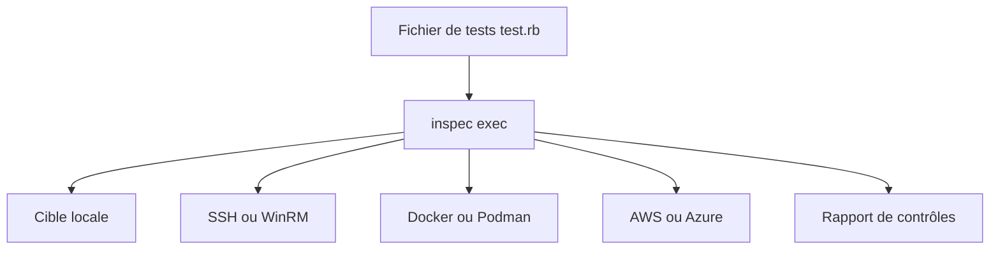

# inspec/inspec

> Framework de test d'infrastructure en Ruby pour exprimer des règles de conformité et de sécurité.

## Le problème
La conformité se vérifie tard, à la main, sans règles exécutables sur les serveurs et conteneurs.

## Ce que ça fait vraiment
On écrit des contrôles en Ruby (`describe package('telnetd')`) et InSpec les exécute en local ou sur une cible distante : SSH, WinRM, Docker, Podman, AWS, Azure. Il fournit des profils partageables, des métadonnées d'impact, et une commande `inspec detect`.

## Comment c'est branché
Schéma simplifié d'après la fiche, sans diagramme fourni.



## Essayer
```bash
gem install inspec-bin
inspec exec test.rb
inspec exec test.rb -t ssh://user@hostname -i /path/to/key
inspec exec test.rb -t docker://container_id
```

## Coût et pièges
Ruby 3.1 ou plus. Depuis la version 5, il faut accepter une EULA Chef pour l'exécutable, et l'installation par paquet passe par un identifiant de licence. Licence non identifiée par GitHub.

## Ce que ce n'est pas
Pas un outil de remédiation : il vérifie, il ne corrige pas. Pas lié à l'IA ni aux données.

## Alternatives
Serverspec et RSpec, dont InSpec s'inspire ; le README renvoie à une page de comparaison.

## Pour toi
À ignorer pour un profil data et IA, sauf si tu audites la conformité d'infrastructures ; la licence et l'EULA sont à lire avant tout usage.

