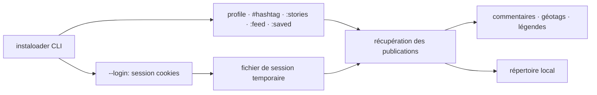

# instaloader/instaloader

> Command-line tool to download Instagram profiles, stories and media.

## The problem
Archiving the public content of an Instagram account by hand is impractical, and an interruption
forces you to start over.

## What it actually does
Instaloader downloads public and private profiles, hashtags, stories, feeds and saved media,
with the comments, geotags and captions of each post. It automatically detects
profile name changes and renames the target directory accordingly. It allows fine-grained
filtering and a choice of how media is stored, and resumes interrupted iterations. `--fast-update`
stops at the first already-downloaded image; `--latest-stamps` remembers the date of the last
download per profile, which lets you move or delete media while keeping
the archive up to date.

## How it is wired


## Trying it
```bash
pip3 install instaloader
instaloader profile [profile ...]
instaloader --fast-update profile [profile ...]
instaloader --latest-stamps -- profile [profile ...]
instaloader --login=your_username profile [profile ...]
```

## Cost and gotchas
Free, MIT license. Private profiles and stories require an Instagram account and
`--login`; session cookies are written in clear text to a file in the temporary directory, which you should
protect. The tool depends entirely on a third-party platform it does not control.

## What it is not
The README is explicit: the project is not affiliated with, authorized, maintained, sponsored or endorsed by
Instagram — use at your own risk. It is not an official API, nor an analysis tool: it
downloads, it does not process.

## Alternatives
No alternative is named; the README only mentions its sponsors (SocialAPIs,
@rocketapi-io), which are third-party API services, not documented replacements.

## For you
Useful occasionally to build a corpus of images or captions, keeping in mind the
unofficial status and the rights questions around collected content.
