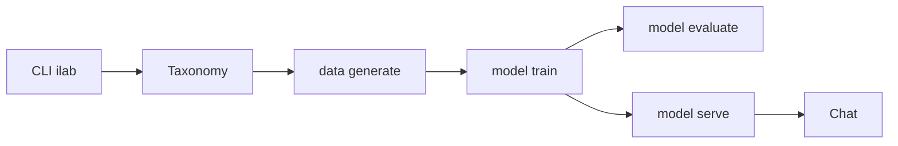

# instructlab/instructlab

> `ilab` CLI for LLM alignment through synthetic data, now archived and split into separate repositories.

## The problem
Adding knowledge or skills to a model without retraining it by hand, from a taxonomy and generated data.

## What it actually does
The current README no longer describes the tool: it announces that the building blocks have moved to dedicated repositories (SDG and Training, at the Red Hat AI Innovation Team). According to the code, the CLI orchestrated config, model download, data generation from a taxonomy, training (simple, full, accelerated, phased), evaluation, serving and chat.

## How it is wired

## Trying it
No command documented in the current README.

## Cost and gotchas
Archived repository: no more fixes. Depending on the architecture, the code required dedicated hardware (CUDA, ROCm, MPS) and Hugging Face models; nothing quantified in the README.

## What it is not
It is no longer where the project lives. Do not start a new effort from this repository.

## Alternatives
- Red-Hat-AI-Innovation-Team/sdg_hub: synthetic data generation, where this building block moved.
- Red-Hat-AI-Innovation-Team/training_hub: training, where this building block moved.

## For you
Ignore: archived, and the README itself points to `sdg_hub` and `training_hub`, to look at instead.
