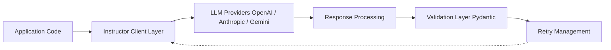

# instructor-ai/instructor

> Python library that extracts Pydantic-validated structured outputs from any LLM.

## The problem
Parsing LLM JSON, validating fields and retrying on error is tedious and specific to each provider.

## What it actually does
You define a Pydantic model and call `client.chat.completions.create(response_model=...)`. Instructor sends the schema to the provider, validates the response and retries with the error message (`max_retries`). A single `from_provider("openai/…")` call covers OpenAI, Anthropic, Google, Ollama, Groq. Nested objects and streaming are handled.

## How it is wired


## Trying it
```bash
pip install instructor
```
```python
client = instructor.from_provider("openai/gpt-4o-mini")
user = client.chat.completions.create(response_model=User, messages=[...])
```

## Cost and gotchas
Provider key and token bill; each retry consumes tokens. The usage figures (3M downloads) are the README's.

## What it is not
Not an agent framework: the README points to PydanticAI for that. Does not guarantee semantic correctness, only format.

## Alternatives
- PydanticAI: agents, traces and evaluations with the same models.
- LangChain and LlamaIndex: compared, judged heavier for this use.

## For you
Adopt for any structured extraction from an LLM: minimal API, typed validation, provider switching without rewrites.
