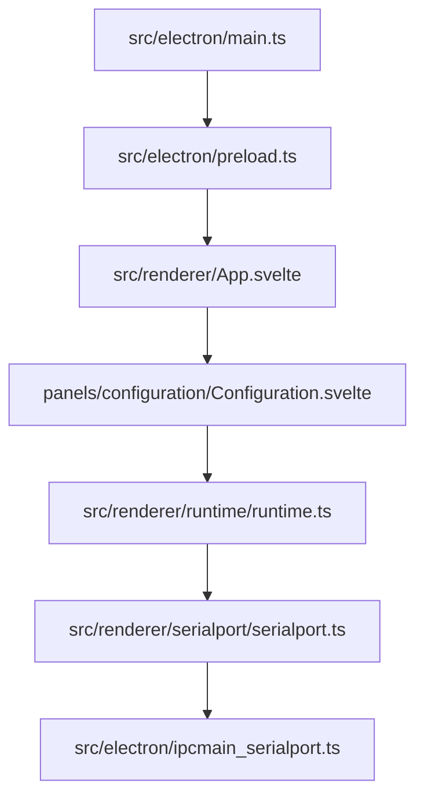

# intechstudio/grid-editor

> Electron and web editor for configuring Intech Studio's Grid hardware controllers.

## The problem
Programming modular MIDI controllers requires an interface to compose their actions.

## What it actually does
An Electron application with a Svelte interface where you compose action blocks. The runtime sends the configuration to the Grid hardware through the serial port managed by the main process. A web version is deployed on Cloudflare Workers, with Firebase for authentication and a shared Profile Cloud. The README mostly describes development and Linux issues (Flatpak, Web Serial).

## How it is wired


## Trying it
```bash
npm i
npm run electron-dev
npm run web-dev
```

## Cost and gotchas
Node, npm and a Grid controller for real use. On Linux, membership in the `dialout` group and a restart. Authentication goes through Firebase.

## What it is not
Useless without the Grid hardware; not a data tool.

## Alternatives
No alternative named in the README.

## For you
Ignore: software for a hardware music controller, outside the data, AI and MLOps scope.
