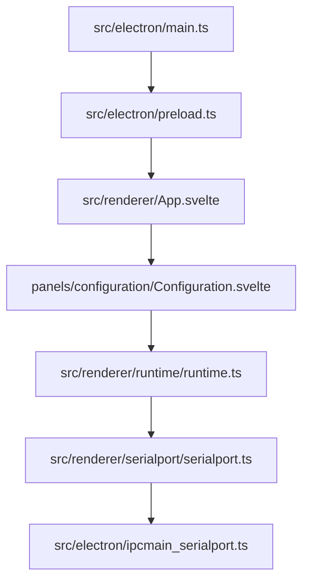

# intechstudio/grid-editor

> Éditeur Electron et web pour configurer les contrôleurs matériels Grid d'Intech Studio.

## Le problème
Programmer des contrôleurs MIDI modulaires demande une interface pour composer leurs actions.

## Ce que ça fait vraiment
Application Electron avec interface Svelte où l'on compose des blocs d'actions. Le runtime envoie la configuration au matériel Grid par le port série géré par le processus principal. Une version web est déployée sur Cloudflare Workers, avec Firebase pour l'authentification et un Profile Cloud partagé. Le README décrit surtout le développement et les soucis sous Linux (Flatpak, Web Serial).

## Comment c'est branché


## Essayer
```bash
npm i
npm run electron-dev
npm run web-dev
```

## Coût et pièges
Node, npm et un contrôleur Grid pour l'usage réel. Sous Linux, appartenance au groupe `dialout` et redémarrage. L'authentification passe par Firebase.

## Ce que ce n'est pas
Pas utile sans le matériel Grid ; pas un outil de data.

## Alternatives
Aucune alternative nommée dans le README.

## Pour toi
À ignorer : logiciel d'un contrôleur matériel de musique, hors du champ data, IA et MLOps.

