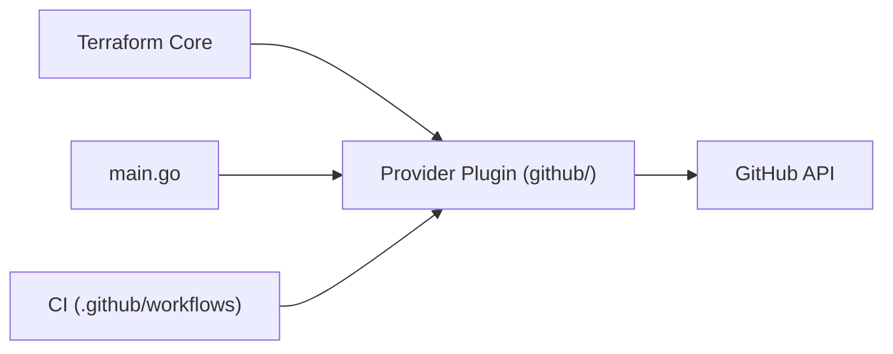

# integrations/terraform-provider-github

> Terraform provider to manage GitHub repositories, teams, protections and settings as infrastructure-as-code.

## The problem
Configuring repositories, teams and branch protections by hand drifts quickly and is not auditable.

## What it actually does
Very short README: manages repositories, teams, branch protections, Actions secrets/variables, organization settings, rulesets, deploy keys and webhooks, on GitHub.com and Enterprise Server via REST and GraphQL. Details are deferred to the Terraform Registry documentation.

## How it is wired


## Trying it
```hcl
provider "github" {
  owner = "my-org"
}

resource "github_repository" "example" {
  name        = "example-repo"
  description = "Managed by Terraform"
  visibility  = "private"
}
```

## Cost and gotchas
Free; Terraform 1.x required, Go 1.26.x only to build. A GitHub token or app is needed (not detailed in this README). 341 open issues.

## What it is not
This README is not the documentation: insufficient material to judge resource coverage or authentication.

## Alternatives
The README cites no alternative.

## For you
Worth adopting if you manage a GitHub organization with Terraform, but only for the platform side; of no interest for pure data work.
