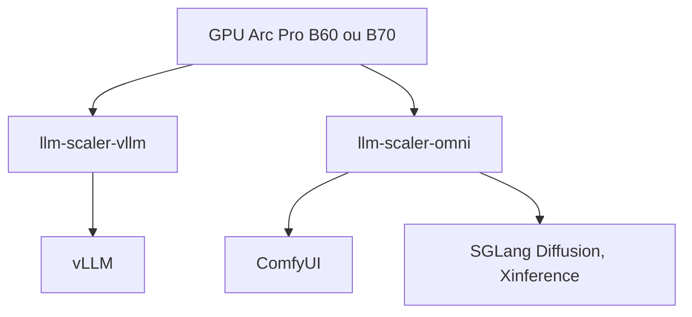

# intel/llm-scaler

> Generative AI Docker images (text, image, video) for Intel Arc Pro B60 and B70 GPUs.

## The problem
vLLM and ComfyUI are designed for NVIDIA; on an Intel Arc GPU, installation and optimization are tedious.

## What it actually does
Two images: `llm-scaler-vllm` (vLLM, INT4/FP8 quantization, embeddings, multimodal, tensor parallelism) and `llm-scaler-omni` (ComfyUI, SGLang Diffusion, Xinference), the latter experimental. The README mostly lists released versions and supported models (Qwen, Wan2.2, Flux).

## How it is wired


## Trying it
```bash
# Aucune commande documentée dans le README : suivre le guide Getting Started (lien).
```

## Cost and gotchas
Free, but requires an Intel Arc Pro B60 or B70 GPU and Docker. 175 open issues, beta versions (b1, b2).

## What it is not
Not an inference engine of its own: it packages vLLM and ComfyUI. It does not target NVIDIA or AMD GPUs.

## Alternatives
No alternative named in the README.

## For you
Watch: only of interest if you have an Intel Arc Pro card, otherwise irrelevant.
