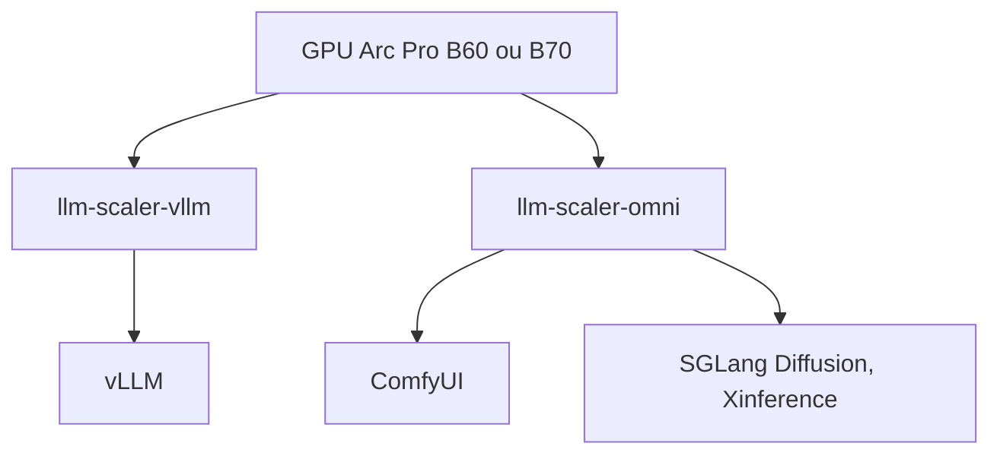

# intel/llm-scaler

> Images Docker d'IA générative (texte, image, vidéo) pour GPU Intel Arc Pro B60 et B70.

## Le problème
vLLM et ComfyUI sont pensés pour NVIDIA ; sur un GPU Intel Arc, l'installation et l'optimisation sont fastidieuses.

## Ce que ça fait vraiment
Deux images : `llm-scaler-vllm` (vLLM, quantification INT4/FP8, embeddings, multimodal, parallélisme tensoriel) et `llm-scaler-omni` (ComfyUI, SGLang Diffusion, Xinference), cette dernière expérimentale. Le README liste surtout des versions publiées et des modèles pris en charge (Qwen, Wan2.2, Flux).

## Comment c'est branché


## Essayer
```bash
# Aucune commande documentée dans le README : suivre le guide Getting Started (lien).
```

## Coût et pièges
Gratuit, mais exige un GPU Intel Arc Pro B60 ou B70 et Docker. 175 issues ouvertes, versions en bêta (b1, b2).

## Ce que ce n'est pas
Pas un moteur d'inférence propre : il empaquette vLLM et ComfyUI. Ne vise pas les GPU NVIDIA ou AMD.

## Alternatives
Aucune alternative nommée dans le README.

## Pour toi
Surveiller : intéressant seulement si tu disposes d'une carte Intel Arc Pro, sinon sans objet.

