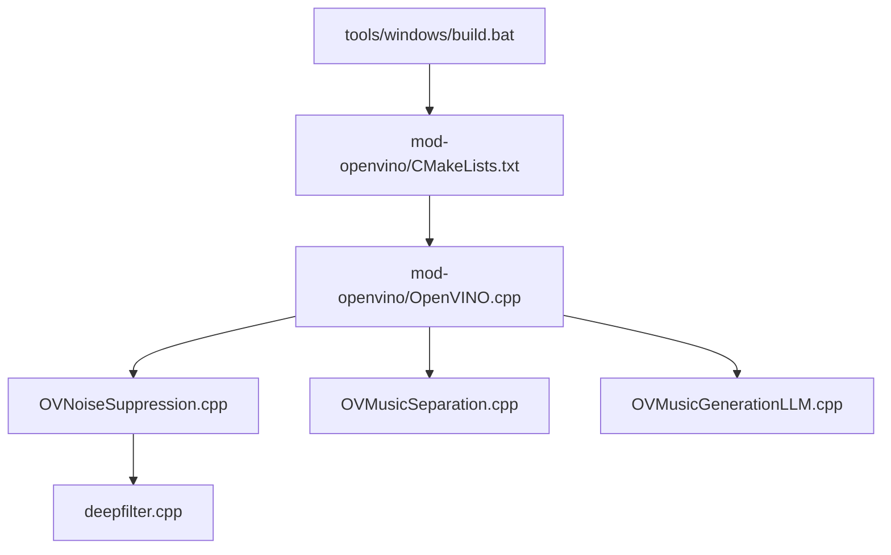

# intel/openvino-plugins-ai-audacity

> Local AI audio effects for Audacity (separation, noise removal, music, transcription), run through OpenVINO.

## The problem
AI audio processing often goes through online services, whereas you want to run it locally on your own hardware.

## What it actually does
Audacity module (mod-openvino) offering five effects: track separation (htdemucs), noise suppression (DeepFilterNet), music generation and continuation (MusicGen), Whisper transcription (whisper.cpp) and audio super-resolution (AudioSR). Runs locally on CPU, GPU or NPU, with no Internet connection.

## How it is wired

## Trying it
No command documented in the README: it points to the Windows installation packages and the Windows and Linux build instructions.

## Cost and gotchas
Free. Installation packages provided for Windows; Linux requires building. The models run on a supported Intel accelerator; GPL-3.0 license (copyleft).

## What it is not
Not an audio editor: it is a plugin for Audacity. Not a cloud service.

## Alternatives
No alternative named in the README.

## For you
Worth watching: a concrete example of local OpenVINO inference (Whisper, MusicGen), instructive for edge MLOps.
