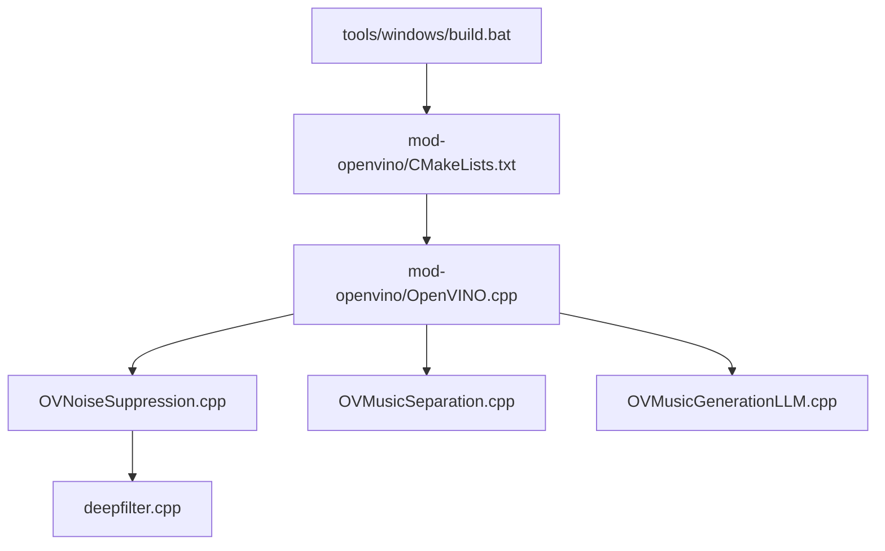

# intel/openvino-plugins-ai-audacity

> Effets audio IA locaux pour Audacity (séparation, débruitage, musique, transcription), exécutés via OpenVINO.

## Le problème
Les traitements audio par IA passent souvent par des services en ligne, alors qu'on veut les exécuter localement sur son propre matériel.

## Ce que ça fait vraiment
Module Audacity (mod-openvino) offrant cinq effets : séparation de pistes (htdemucs), suppression de bruit (DeepFilterNet), génération et continuation de musique (MusicGen), transcription Whisper (whisper.cpp) et super-résolution audio (AudioSR). Exécution locale sur CPU, GPU ou NPU, sans connexion Internet.

## Comment c'est branché

## Essayer
Aucune commande documentée dans le README : il renvoie aux paquets d'installation Windows et aux instructions de build Windows et Linux.

## Coût et pièges
Gratuit. Paquets d'installation fournis pour Windows ; Linux demande de compiler. Les modèles tournent sur un accélérateur Intel pris en charge ; licence GPL-3.0 (copyleft).

## Ce que ce n'est pas
Pas un éditeur audio : c'est un greffon pour Audacity. Pas un service cloud.

## Alternatives
Aucune alternative nommée dans le README.

## Pour toi
À surveiller : exemple concret d'inférence OpenVINO locale (Whisper, MusicGen), instructif pour le MLOps en périphérie.

