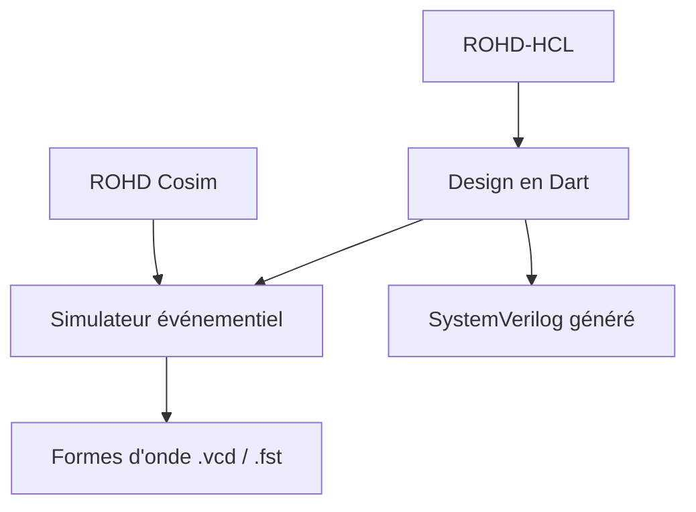

# intel/rohd

> Dart framework for describing, simulating and verifying digital hardware, with SystemVerilog generation.

## The problem
Classic hardware design flows rely on SystemVerilog, heavy EDA tools and ad hoc scripts.

## What it actually does
Lets you describe circuits in Dart, simulate them (event-driven, 4 values 0/1/X/Z) with VCD or FST waveform capture, and generate readable SystemVerilog. It adds a component library (ROHD-HCL), a verification framework, a schematic viewer and Verilog cosimulation.

## How it is wired
The README does not detail the internal architecture.


## Trying it
```bash
# Aucune commande dans le README : voir la page Setup & Install du site ROHD
# ou ouvrir le dépôt dans un GitHub Codespace.
```

## Cost and gotchas
Free. You need to know Dart and hardware design. The README states that ROHD is neither a new language, nor an HDL, nor high-level synthesis.

## What it is not
Not a synthesis or machine learning tool: it describes and verifies silicon.

## Alternatives
No alternative named in the README; it aims to replace SystemVerilog on the front-end side.

## For you
Ignore: chip design domain, useful only if you work on hardware accelerators for AI.
