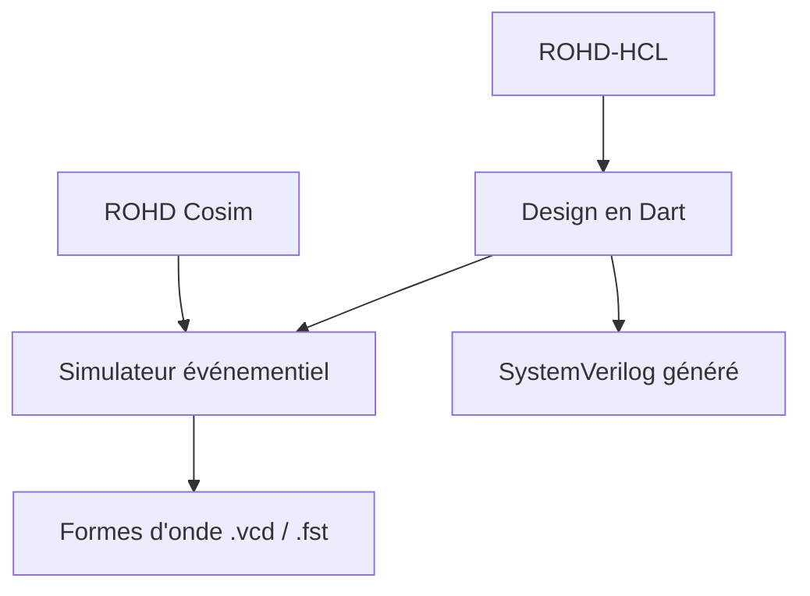

# intel/rohd

> Framework Dart pour décrire, simuler et vérifier du matériel numérique, avec génération de SystemVerilog.

## Le problème
Les flux de conception matérielle classiques reposent sur SystemVerilog, des outils EDA lourds et des scripts ad hoc.

## Ce que ça fait vraiment
Permet de décrire des circuits en Dart, de les simuler (événementiel, 4 valeurs 0/1/X/Z) avec capture de formes d'onde VCD ou FST, et de générer du SystemVerilog lisible. S'y ajoutent une bibliothèque de composants (ROHD-HCL), un cadre de vérification, un visualiseur de schémas et la cosimulation Verilog.

## Comment c'est branché
Le README ne détaille pas l'architecture interne.


## Essayer
```bash
# Aucune commande dans le README : voir la page Setup & Install du site ROHD
# ou ouvrir le dépôt dans un GitHub Codespace.
```

## Coût et pièges
Gratuit. Il faut connaître Dart et la conception matérielle. Le README précise que ROHD n'est ni un nouveau langage, ni un HDL, ni de la synthèse de haut niveau.

## Ce que ce n'est pas
Pas un outil de synthèse ni de machine learning : il décrit et vérifie du silicium.

## Alternatives
Aucune alternative nommée dans le README ; il vise à remplacer SystemVerilog côté front-end.

## Pour toi
À ignorer : domaine conception de puces, utile seulement si tu travailles sur des accélérateurs matériels pour l'IA.

