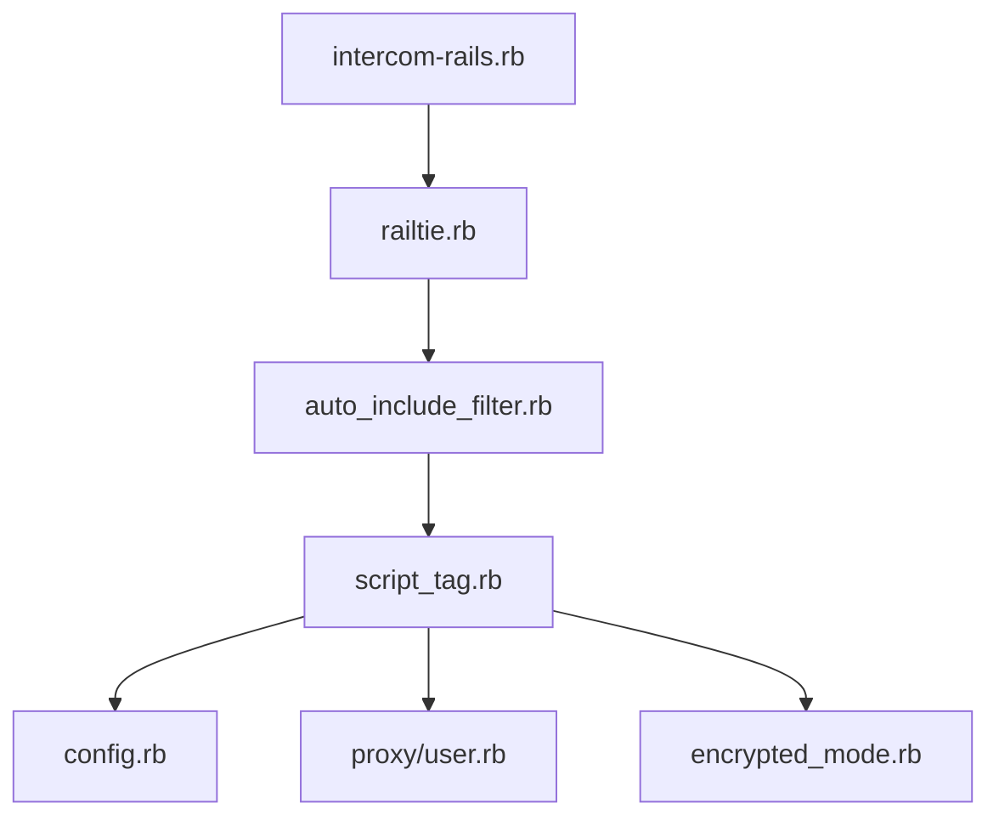

# intercom/intercom-rails

> Rails gem that installs Intercom messaging in an app by inserting the script automatically.

## The problem
Wiring the Intercom widget (identifiers, security, user data) into every Rails page by hand.

## What it actually does
A railtie adds a filter that inserts the script tag before the end of the body, built by `script_tag.rb` from the config and the current user. It handles custom data, companies, encrypted mode (HMAC or JWT) and session shutdown (`ShutdownHelper`).

## How it is wired


## Trying it
```bash
bundle install
rails generate intercom:config YOUR-APP-ID
bundle exec rspec spec/
```

## Cost and gotchas
An Intercom account is required (paid plan, not detailed). First-party cookies: the Intercom session must be closed on logout. The API secret must not be committed to version control.

## What it is not
Not access to Intercom's REST API: for that, use the `intercom` gem.

## Alternatives
The `intercom` gem, cited in the README for the REST API.

## For you
Ignore: integration of a customer support service into Rails, off-topic for data/AI/MLOps.
