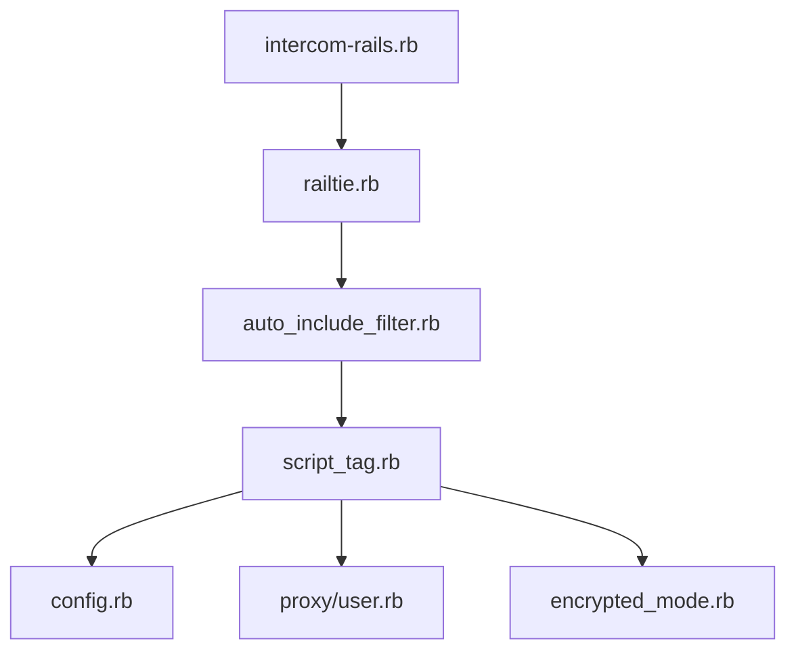

# intercom/intercom-rails

> Gem Rails qui installe la messagerie Intercom dans une appli en insérant le script automatiquement.

## Le problème
Brancher le widget Intercom (identifiants, sécurité, données utilisateur) dans chaque page Rails à la main.

## Ce que ça fait vraiment
Un railtie ajoute un filtre qui insère la balise script avant la fin du body, construite par `script_tag.rb` depuis la config et l'utilisateur courant. Il gère données personnalisées, entreprises, mode chiffré (HMAC ou JWT) et fermeture de session (`ShutdownHelper`).

## Comment c'est branché


## Essayer
```bash
bundle install
rails generate intercom:config YOUR-APP-ID
bundle exec rspec spec/
```

## Coût et pièges
Compte Intercom requis (offre payante, non détaillée). Cookies de première partie : il faut fermer la session Intercom à la déconnexion. Le secret d'API ne doit pas être versionné.

## Ce que ce n'est pas
Pas l'accès à l'API REST d'Intercom : pour cela, la gem `intercom`.

## Alternatives
La gem `intercom`, citée dans le README pour l'API REST.

## Pour toi
Ignorer : intégration d'un service de support client dans Rails, hors sujet data/IA/MLOps.

