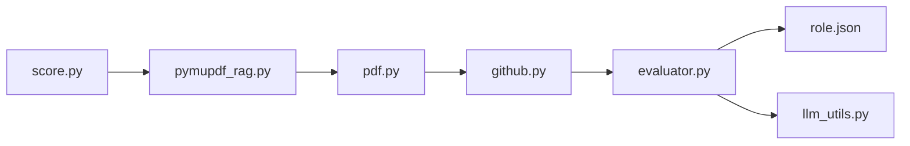

# interviewstreet/hiring-agent

> CLI that ranks PDF resumes against a per-role rubric, using an LLM and GitHub signals.

## The problem
HackerRank receives 50,000 to 60,000 internship applications a year: it is impossible to read them all in a relevant order.

## What it actually does
PyMuPDF converts the PDF to Markdown, then section-by-section extraction via Jinja templates produces a JSON Resume.
GitHub enrichment: the LLM picks 7 significant repositories.
`evaluator.py` scores against a role defined in `roles/<name>/role.json` (categories, weights, bonuses).
Ollama locally (gemma4) or Gemini; CSV export in development mode.

## How it is wired


## Trying it
```bash
pip install -r requirements.txt
ollama pull gemma4:latest
python score.py ./resume/sample.pdf --role software_engineering_intern
```

## Cost and gotchas
Free with Ollama; Gemini key otherwise. Scores vary strongly from one run to the next (non-determinism), and invisible text in a PDF can inflate the score.

## What it is not
Not an ATS, and not HackerRank's production tool: the provided configuration is a demo. It raises ethical and GDPR questions (Article 22).

## Alternatives
No alternative named in the README.

## For you
Worth watching as a case study: a well-structured LLM extraction and scoring pipeline, whose documented variance teaches more than the tool itself.
